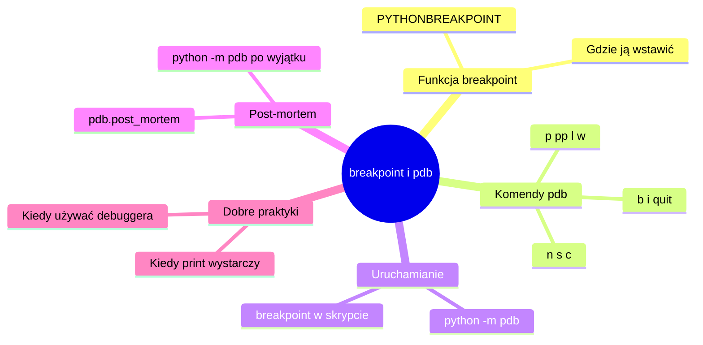

# 🐞 Mikro tutorial: `breakpoint()` i `pdb` w praktyce

> Ten materiał uzupełnia sekcje **17–23** z `teoria.md` (Debugowanie, Breakpoint, Krokowanie po kodzie, Variables panel, Call stack) — tamte sekcje pokazują **koncepcje** debugowania na przykładzie debuggera w IDE. Tutaj wchodzi konkretne narzędzie wbudowane w samego Pythona: funkcja `breakpoint()` i moduł `pdb`, działające identycznie w terminalu, w PyCharmie, w VSCode i na serwerze bez żadnego IDE.



## Spis treści

- [1. Po co `breakpoint()`, skoro mam debugger w IDE?](#1-po-co-breakpoint-skoro-mam-debugger-w-ide)
- [2. Pierwsze zatrzymanie programu](#2-pierwsze-zatrzymanie-programu)
- [3. Najważniejsze komendy `pdb`](#3-najważniejsze-komendy-pdb)
  - [3.1 Poruszanie się po kodzie](#31-poruszanie-się-po-kodzie)
  - [3.2 Podglądanie danych](#32-podglądanie-danych)
  - [3.3 Kontekst i orientacja](#33-kontekst-i-orientacja)
- [4. Uruchamianie całego skryptu pod `pdb`](#4-uruchamianie-całego-skryptu-pod-pdb)
- [5. Debugowanie post-mortem — gdy program już zgłosił wyjątek](#5-debugowanie-post-mortem--gdy-program-już-zgłosił-wyjątek)
- [6. Breakpoint warunkowy](#6-breakpoint-warunkowy)
- [7. Wyłączanie `breakpoint()` bez usuwania z kodu](#7-wyłączanie-breakpoint-bez-usuwania-z-kodu)
- [❗ Najczęstsze błędy](#-najczęstsze-błędy)
- [🎓 Podsumowanie i ściąga](#-podsumowanie-i-ściąga)
- [📝 Zadania do samodzielnej pracy](#-zadania-do-samodzielnej-pracy)
- [📚 Dodatkowe materiały](#-dodatkowe-materiały)

---

## 🎯 Cele zajęć

Po tym mikro tutorialu będziesz umieć:

- zatrzymać działający program w dowolnym miejscu za pomocą `breakpoint()`,
- poruszać się po kodzie w `pdb` (kolejna linia, wejście do funkcji, kontynuacja),
- podejrzeć wartości zmiennych i stan programu w trakcie zatrzymania,
- uruchomić cały skrypt pod kontrolą debuggera z terminala (`python -m pdb`),
- automatycznie wejść w debugger dokładnie w miejscu, gdzie program zgłosił wyjątek (post-mortem),
- wyłączyć debugowanie jednym poleceniem, bez wycinania `breakpoint()` z kodu.

## ✅ Wymagania wstępne

- Znasz podstawy funkcji, zmiennych i pętli w Pythonie.
- Rozumiesz, czym jest traceback i błąd typu/logiczny (sekcje 17–19 w `teoria.md`).
- **Nie zakładamy** wcześniejszego doświadczenia z linią poleceń w roli debuggera — wszystkie komendy `pdb` wprowadzamy od zera.

> [!NOTE]
> Wersja Pythona: `breakpoint()` jest dostępny od **Pythona 3.7**. Jeśli pracujesz na starszej wersji, jedyna różnica to wstawianie ręcznie `import pdb; pdb.set_trace()` zamiast `breakpoint()` — działanie jest identyczne.

---

# 1. Po co `breakpoint()`, skoro mam debugger w IDE?

Debugger w PyCharmie czy VSCode robi dokładnie to samo, co `pdb` — tylko chowa komendy tekstowe za przyciskami i ładnymi panelami. `breakpoint()` przydaje się, gdy:

- pracujesz w terminalu, na serwerze, przez SSH, gdzie nie ma żadnego IDE,
- debugujesz proces uruchamiany przez inne narzędzie (np. `pytest`, `gunicorn`, `cron`) i nie da się tam po prostu kliknąć "ustaw breakpoint" w edytorze,
- chcesz, żeby breakpoint **pojechał razem z kodem** (np. w repozytorium, w Dockerze) niezależnie od tego, kto i w jakim IDE go uruchomi,
- chcesz zrozumieć, co IDE robi "pod maską" — to ta sama wiedza, tylko bez interfejsu graficznego.

> [!TIP]
> Wszystkie pojęcia z sekcji 21–23 teorii (`step over`, `step into`, `step out`, variables panel, call stack) mają swoje dokładne odpowiedniki w komendach `pdb`, których nauczysz się w tej sekcji. To nie jest nowa wiedza — to ta sama wiedza w innym ubraniu.

---

# 2. Pierwsze zatrzymanie programu

`breakpoint()` to zwykłe wywołanie funkcji, wstawiane w dowolnym miejscu kodu:

```python
# pricing.py
def calculate_line_total(quantity, unit_price):
    breakpoint()
    total = quantity * unit_price
    return total

result = calculate_line_total(5, 12.5)
print("Wynik:", result)
```

Efekt uruchomienia `python pricing.py`:

```text
> pricing.py(3)calculate_line_total()
-> total = quantity * unit_price
(Pdb)
```

| Fakt | Znaczenie |
|---|---|
| Program stoi w miejscu `breakpoint()` | Nie kończy działania — czeka na komendy |
| `(Pdb)` to nowy tryb wejścia | Od tej chwili konsola przyjmuje komendy `pdb`, nie zwykły kod Pythona |
| `quantity` (sama nazwa zmiennej) | Wypisuje jej wartość |
| `n` | Wykonuje kolejną linię (komendy poruszania się — sekcja 3) |

> [!IMPORTANT]
> `breakpoint()` zatrzymuje program **przed** wykonaniem linii, która jest pod nim w kodzie — nie po niej. Dlatego `(Pdb)` pokazuje `-> total = ...` jako linię, która **zaraz** się wykona, a nie tę, która już się wykonała.

---

## Zadania — sekcja 2

> [!TIP]
> **Zapamiętaj z tej sekcji:**
> - `breakpoint()` wstawia się jak zwykłe wywołanie funkcji, w dowolnym miejscu kodu.
> - Program zatrzymuje się tuż **przed** wykonaniem linii następującej po `breakpoint()`.
> - Po zatrzymaniu program czeka w konsoli `(Pdb)` na Twoje komendy.

**Zadanie 1: Zatrzymaj program w pętli**

Napisz funkcję `find_negative(numbers)`, która iteruje po liście liczb i wstaw `breakpoint()` wewnątrz pętli `for`. Uruchom skrypt na liście `[3, 7, -2, 9]` i w konsoli `pdb` sprawdź wartość zmiennej iterującej, wpisując po prostu jej nazwę, a następnie zakończ debugowanie komendą `c` (continue).

<details>
<summary>Rozwiązanie</summary>

```python
def find_negative(numbers):
    for number in numbers:
        breakpoint()
        if number < 0:
            return number
    return None

print(find_negative([3, 7, -2, 9]))
```

Po uruchomieniu `python skrypt.py` w konsoli `(Pdb)` wpisujesz `number`, żeby zobaczyć aktualną wartość, i `c`, żeby przejść do kolejnego zatrzymania (breakpoint wykona się ponownie w kolejnej iteracji pętli — to normalne, bo `breakpoint()` jest wewnątrz `for`).
</details>

---

# 3. Najważniejsze komendy `pdb`

Gdy program jest zatrzymany w `(Pdb)`, masz do dyspozycji zestaw krótkich komend. Nie musisz znać ich wszystkich — te poniżej pokrywają 95% realnych sytuacji.

## 3.1 Poruszanie się po kodzie

| Komenda | Skrót | Znaczenie | Odpowiednik z sekcji 21 teorii |
|---|---|---|---|
| `next` | `n` | Wykonaj bieżącą linię, nie wchodź do środka wywoływanych funkcji | `step over` |
| `step` | `s` | Wejdź do środka wywoływanej funkcji | `step into` |
| `return` | `r` | Dokończ wykonywanie bieżącej funkcji i zatrzymaj się tuż po jej `return` | `step out` |
| `continue` | `c` | Wznów normalne działanie programu do kolejnego breakpointa | `continue` |
| `until` | `unt` | Jak `next`, ale dodatkowo pozwala "przeskoczyć" pętlę do jej końca | — |
| `quit` | `q` | Przerwij debugowanie i zakończ program | `stop` |

```python
def calculate_total(items):
    total = 0
    for price in items:
        total += price
    return total

breakpoint()
print(calculate_total([10, 20, 30]))
```

Sesja w terminalu — `s` wchodzi do środka `calculate_total`, kilka `n` przesuwa nas linia po linii, `c` kończy debugowanie:

```text
> demo.py(8)<module>()
-> print(calculate_total([10, 20, 30]))
(Pdb) s
--Call--
> demo.py(1)calculate_total()
-> def calculate_total(items):
(Pdb) n
> demo.py(2)calculate_total()
-> total = 0
(Pdb) n
> demo.py(3)calculate_total()
-> for price in items:
(Pdb) c
60
```

## 3.2 Podglądanie danych

| Komenda | Znaczenie |
|---|---|
| `nazwa_zmiennej` | Wypisz wartość zmiennej (jeśli nazwa nie koliduje z komendą `pdb`) |
| `p wyrażenie` | Wypisz wynik dowolnego wyrażenia Pythona (bezpieczna, jednoznaczna forma) |
| `pp wyrażenie` | Jak `p`, ale ładnie sformatowane (przydatne dla list/słowników) |
| `whatis wyrażenie` | Pokaż typ wyrażenia |
| `!kod` | Wykonaj dowolny kod Pythona, np. `!total = 0`, żeby zmienić wartość na żywo |

```text
(Pdb) p quantity
5
(Pdb) pp data
{'a': 1, 'b': {'c': 2, 'd': [1, 2, 3]}}
```

> [!TIP]
> Używaj `p` zamiast samej nazwy zmiennej, gdy nazwa zmiennej pokrywa się z komendą `pdb` (np. zmienna `list`, `next` albo `c`). `p list` zawsze zadziała poprawnie, sama nazwa `list` może zostać źle zinterpretowana.

## 3.3 Kontekst i orientacja

| Komenda | Znaczenie | Odpowiednik z teorii |
|---|---|---|
| `l` (list) | Pokaż kilka linii kodu wokół aktualnego miejsca | — |
| `w` (where) | Pokaż call stack — jak program dotarł do tego miejsca | sekcja 23: Call stack |
| `a` (args) | Pokaż argumenty bieżącej funkcji | Variables panel (argumenty) |
| `b` (break) | Ustaw breakpoint na konkretnej linii bez modyfikowania kodu (można dodać warunek — zobacz sekcję 6) | — |

Przykład `l`:

```text
(Pdb) l
  1  	def calculate_total(items):
  2  	    total = 0
  3  	    for price in items:
  4  	        breakpoint()
  5  ->	        total += price
  6  	    return total
  7  	
  8  	print(calculate_total([10, 20, 30]))
```

Strzałka `->` pokazuje linię, na której jesteś teraz.

Przykład `w` (call stack) dla funkcji wywołanej z głębi programu:

```text
(Pdb) w
  demo.py(9)<module>()
-> main()
  demo.py(6)main()
-> generate_report()
> demo.py(2)generate_report()
-> total = calculate_total(items)
```

Kierunek odczytu: od góry do dołu, od najstarszego wywołania do aktualnego miejsca (oznaczonego `>`). W tym przykładzie: `main()` → `generate_report()` → aktualna linia. To dokładnie ten sam call stack, o którym mówi sekcja 23 teorii — tylko w formie tekstowej.

> [!NOTE]
> **Szybkie pytanie:** Stoisz w funkcji `calculate_discount()`, wywołanej przez `process_order()`. Chcesz zobaczyć, co dzieje się wewnątrz kolejnej linii tej funkcji, ale bez wchodzenia w żadne funkcje, które ona wywołuje. Jakiej komendy użyjesz — `n` czy `s`?
>
> <details>
> <summary>Odpowiedź</summary>
> `n` (next / step over). `s` (step into) wszedłby do środka pierwszej napotkanej funkcji wywołanej w tej linii — czego akurat nie chcesz.
> </details>

---

## Zadania — sekcja 3

> [!TIP]
> **Zapamiętaj z tej sekcji:**
> - `n` = step over, `s` = step into, `c` = continue, `q` = zakończ.
> - `p wyrażenie` bezpiecznie wypisuje wartość — działa nawet, gdy nazwa zmiennej koliduje z komendą.
> - `l` pokazuje kod wokół aktualnej linii, `w` pokazuje call stack.

**Zadanie 2: Prześledź call stack**

Napisz trzy zagnieżdżone funkcje: `main()` wywołuje `process_order()`, a `process_order()` wywołuje `calculate_discount(price)`. Wstaw `breakpoint()` wewnątrz `calculate_discount`, uruchom program i użyj komendy `w`, żeby zobaczyć pełną ścieżkę wywołań. Zakończ debugowanie przez `c`.

<details>
<summary>Rozwiązanie</summary>

```python
def calculate_discount(price):
    breakpoint()
    return price * 0.9

def process_order(price):
    return calculate_discount(price)

def main():
    total = process_order(100)
    print("Total:", total)

main()
```

Po zatrzymaniu wpisz `w` — zobaczysz trzy poziomy: `main()` → `process_order()` → `calculate_discount()`, dokładnie w tej kolejności, w jakiej program tam dotarł.
</details>

---

# 4. Uruchamianie całego skryptu pod `pdb`

Alternatywa dla wstawiania `breakpoint()` w kod: uruchomienie **całego skryptu** pod kontrolą debuggera, bez modyfikowania pliku.

```bash
python -m pdb skrypt.py
```

Ten tryb zawsze zatrzymuje program od razu na pierwszej linii, zanim cokolwiek się wykona:

```text
> skrypt.py(1)<module>()
-> def divide(a, b):
(Pdb)
```

Standardowy przebieg pracy w tym trybie:

1. `b 8` — ustaw breakpoint na konkretnej linii, bez ruszania kodu źródłowego.
2. `c` — wznów program, który zatrzyma się dopiero na wskazanej linii.

```text
(Pdb) b 8
Breakpoint 1 at skrypt.py:8
(Pdb) c
> skrypt.py(8)main()
-> print(divide(x, y))
```

> [!NOTE]
> `python -m pdb skrypt.py` przydaje się przy debugowaniu cudzego kodu (bez ruszania pliku) oraz gdy problem pojawia się bardzo wcześnie — jeszcze przed pierwszą linią, w której dałoby się ręcznie wstawić `breakpoint()`.

---

# 5. Debugowanie post-mortem — gdy program już zgłosił wyjątek

Najczęstszy scenariusz w praktyce: program zgłosił wyjątek, a stan zmiennych trzeba zobaczyć **dokładnie w miejscu awarii**, bez zgadywania, gdzie ręcznie wstawić `breakpoint()`.

## Wariant A: `python -m pdb` automatycznie

```bash
python -m pdb skrypt.py
```

Tak jak w sekcji 4, program najpierw zatrzymuje się na pierwszej linii, a `c` go uruchamia. Różnica: jeśli po drodze pojawi się nieobsłużony wyjątek, `pdb` **sam** wchodzi w tryb debugowania dokładnie w miejscu błędu — bez ustawiania jakiegokolwiek dodatkowego breakpointa.

```python
# skrypt.py
def divide(a, b):
    result = a / b
    return result

def main():
    x = 10
    y = 0
    print(divide(x, y))

main()
```

```text
> skrypt.py(1)<module>()
-> def divide(a, b):
(Pdb) c
Traceback (most recent call last):
  ...
ZeroDivisionError: division by zero
Uncaught exception. Entering post mortem debugging
> skrypt.py(2)divide()
-> result = a / b
(Pdb) p a
10
(Pdb) p b
0
```

Wartości `a` i `b`, które doprowadziły do błędu, są widoczne od razu — bez ponownego uruchamiania programu z ręcznie zgadywanym miejscem `breakpoint()`.

## Wariant B: `pdb.post_mortem()` w kodzie

Zastosowanie: przechwycenie konkretnego wyjątku i wejście w debugger tylko wtedy, bez uruchamiania całego skryptu przez `python -m pdb`.

```python
import pdb

def divide(a, b):
    return a / b

def main():
    try:
        divide(10, 0)
    except ZeroDivisionError:
        pdb.post_mortem()

main()
```

```text
> skrypt.py(4)divide()
-> return a / b
(Pdb) p a
10
(Pdb) p b
0
(Pdb) w
  skrypt.py(8)main()
-> divide(10, 0)
> skrypt.py(4)divide()
-> return a / b
```

> [!WARNING]
> `pdb.post_mortem()` bez argumentu działa tylko wywołane **wewnątrz bloku `except`** — korzysta wtedy z informacji o ostatnim wyjątku. Wywołane poza `except` (np. na końcu programu) nie będzie miało żadnego wyjątku do pokazania.

---

## Zadania — sekcja 4 i 5

> [!TIP]
> **Zapamiętaj z tych sekcji:**
> - `python -m pdb skrypt.py` uruchamia cały program pod debuggerem od pierwszej linii.
> - Ten sam `python -m pdb skrypt.py` automatycznie wchodzi w debugger, gdy program zgłosi nieobsłużony wyjątek (post-mortem).
> - `pdb.post_mortem()` wywołane w bloku `except` daje ten sam efekt punktowo, bez uruchamiania całego skryptu przez `-m pdb`.

**Zadanie 3: Znajdź przyczynę `IndexError` post-mortem**

Poniższy kod ma błąd — próbuje odczytać element listy, którego nie ma. Uruchom go przez `python -m pdb skrypt.py` i w trybie post-mortem sprawdź wartości `items` oraz `index`, żeby ustalić dokładną przyczynę.

```python
def get_third_item(items):
    index = 2
    return items[index]

print(get_third_item([10, 20]))
```

<details>
<summary>Rozwiązanie</summary>

Po uruchomieniu `python -m pdb skrypt.py` i wpisaniu `c`, program zgłosi `IndexError`, a `pdb` automatycznie wejdzie w post-mortem w linii `return items[index]`. Wpisując `p items` i `p index`, widzimy `items = [10, 20]` (tylko 2 elementy, indeksy 0 i 1) oraz `index = 2` — stąd błąd: lista ma za mało elementów, żeby zwrócić "trzeci" pod indeksem `2`.

Poprawka:

```python
def get_third_item(items):
    index = 2
    if index >= len(items):
        raise ValueError("Lista ma mniej niż trzy elementy")
    return items[index]
```
</details>

---

# 6. Breakpoint warunkowy

Breakpoint bez warunku w pętli z tysiącem iteracji oznacza tysiąc razy wpisywanie `c`, żeby dotrzeć do jednej złej wartości. Rozwiązanie: zwykły `if` przed `breakpoint()`.

```python
def process(items):
    total = 0
    for item in items:
        if item < 0:
            breakpoint()
        total += item
    return total

print(process([5, 10, -3, 7]))
```

Program zatrzyma się **tylko** wtedy, gdy `item` jest ujemny — dla `5` i `10` breakpoint w ogóle się nie uruchomi:

```text
> skrypt.py(6)process()
-> total += item
(Pdb) p item
-3
(Pdb) p total
15
(Pdb) c
```

> [!TIP]
> To samo można zrobić komendą `b linia, warunek` bez zmieniania kodu, np. `b 6, item < 0` po uruchomieniu `python -m pdb skrypt.py` — efekt jest identyczny, ale kod źródłowy zostaje czysty.

---

# 7. Wyłączanie `breakpoint()` bez usuwania z kodu

Zostawienie `breakpoint()` w kodzie na stałe bywa wygodne (np. w testach albo w miejscu, do którego często się wraca), ale niebezpieczne — na produkcji zawiesza program w oczekiwaniu na input, którego nikt tam nie poda.

Python czyta zmienną środowiskową `PYTHONBREAKPOINT`, decydującą o zachowaniu `breakpoint()`:

```bash
# normalne działanie - wejdź w pdb
python skrypt.py

# całkowicie zignoruj wszystkie breakpoint() w kodzie
PYTHONBREAKPOINT=0 python skrypt.py
```

| Wartość `PYTHONBREAKPOINT` | Efekt |
|---|---|
| (nieustawiona) | Standardowe zachowanie — wejdź do `pdb` |
| `0` | `breakpoint()` nic nie robi — kod leci dalej bez zatrzymania |
| `ipdb.set_trace` | Użyj `ipdb` zamiast wbudowanego `pdb` (jeśli masz je zainstalowane) |

> [!IMPORTANT]
> `PYTHONBREAKPOINT=0` to bezpieczny "wyłącznik główny" — nie musisz ręcznie usuwać ani komentować linii `breakpoint()` w kodzie przed wypchnięciem go dalej. To jeden z powodów, dla których `breakpoint()` jest lepszym wyborem niż stare `import pdb; pdb.set_trace()`, którego nie da się tak łatwo zbiorczo wyłączyć.

---

## Zadania — sekcja 6 i 7

> [!TIP]
> **Zapamiętaj z tych sekcji:**
> - Breakpoint warunkowy = zwykły `if` przed `breakpoint()` albo `b linia, warunek`.
> - `PYTHONBREAKPOINT=0 python skrypt.py` wyłącza wszystkie `breakpoint()` w programie bez ruszania kodu.

**Zadanie 4: Breakpoint tylko dla konkretnego klienta**

Masz listę zamówień, każde jako słownik z kluczami `customer_id` i `amount`. Napisz pętlę, która sumuje `amount`, i ustaw breakpoint uruchamiający się tylko wtedy, gdy `customer_id == "C003"`. Sprawdź, czy potrafisz uruchomić ten sam skrypt z `PYTHONBREAKPOINT=0` tak, żeby przeleciał bez zatrzymania.

<details>
<summary>Rozwiązanie</summary>

```python
orders = [
    {"customer_id": "C001", "amount": 100},
    {"customer_id": "C003", "amount": 250},
    {"customer_id": "C002", "amount": 50},
]

def total_amount(orders):
    total = 0
    for order in orders:
        if order["customer_id"] == "C003":
            breakpoint()
        total += order["amount"]
    return total

print(total_amount(orders))
```

Uruchomienie `python skrypt.py` zatrzyma się tylko dla `C003`. Uruchomienie `PYTHONBREAKPOINT=0 python skrypt.py` wypisze od razu `400` bez żadnego zatrzymania.
</details>

---

# ❗ Najczęstsze błędy

#### ❌ Błąd 1: Zapomniany `breakpoint()` w kodzie wysłanym dalej

```python
def calculate_total(items):
    breakpoint()  # zostało po debugowaniu!
    return sum(items)
```

Jeśli taki kod trafi na serwer produkcyjny albo do CI, program zawiśnie, czekając na input z konsoli `pdb`, którego nikt tam nie poda. Przed commitem sprawdź kod pod kątem zapomnianych `breakpoint()` (np. `grep -rn "breakpoint()" .`), albo zabezpiecz się globalnie ustawiając `PYTHONBREAKPOINT=0` w środowisku produkcyjnym.

#### ❌ Błąd 2: Mylenie `p zmienna` z samym wpisaniem nazwy w niewłaściwym kontekście

```text
(Pdb) list
```

Jeśli masz zmienną o nazwie `list`, samo wpisanie `list` w `pdb` może zostać potraktowane jako próba wywołania wbudowanej komendy albo dać nieoczekiwany wynik. Bezpieczna forma to zawsze `p list`.

#### ❌ Błąd 3: Wielokrotne uruchamianie `c` bez warunku w pętli z breakpointem

```python
for item in bardzo_dluga_lista:
    breakpoint()
    process(item)
```

Bez warunku `if` przed `breakpoint()` zatrzymasz program przy **każdej** iteracji — dla listy z tysiącem elementów oznacza to tysiąc razy wpisywanie `c`. Zawsze dodawaj warunek, gdy breakpoint jest wewnątrz pętli i interesuje Cię tylko konkretny przypadek.

#### ❌ Błąd 4: Próba edycji kodu "na żywo" w `pdb`

`pdb` pozwala zmienić wartość zmiennej (`!total = 0`), ale nie pozwala zmienić samego kodu źródłowego pliku, który się aktualnie wykonuje. Zmiana w edytorze podczas trwającej sesji `pdb` nie wpłynie na już uruchomiony proces — trzeba zakończyć debugowanie (`q`) i uruchomić program od nowa.

---

# 🎓 Podsumowanie i ściąga

- `breakpoint()` zatrzymuje program w dowolnym miejscu i otwiera interaktywną konsolę `pdb` — bez IDE, bez dodatkowych narzędzi.
- Komendy poruszania się (`n`, `s`, `r`, `c`) to dokładnie te same operacje, co `step over` / `step into` / `step out` / `continue` z debuggera w IDE.
- `p` i `pp` podglądają wartości zmiennych, `w` pokazuje call stack, `l` pokazuje kod wokół aktualnej linii.
- `python -m pdb skrypt.py` uruchamia cały program pod debuggerem i automatycznie wchodzi w tryb post-mortem, gdy program zgłosi nieobsłużony wyjątek.
- Warunkowy `if` przed `breakpoint()` (albo `b linia, warunek`) pozwala zatrzymać program tylko w interesującym Cię przypadku.
- `PYTHONBREAKPOINT=0` to bezpieczny wyłącznik wszystkich `breakpoint()` w kodzie, bez ruszania samego kodu.

**Ściąga komend `pdb`:**

```text
n (next)      - wykonaj linię, nie wchodź do funkcji (step over)
s (step)      - wejdź do środka wywoływanej funkcji (step into)
r (return)    - dokończ bieżącą funkcję (step out)
c (continue)  - wznów program do kolejnego breakpointa
unt (until)   - jak next, ale pozwala przeskoczyć pętlę
q (quit)      - przerwij debugowanie i zakończ program

p wyrażenie   - wypisz wartość wyrażenia
pp wyrażenie  - wypisz wartość ładnie sformatowaną
l (list)      - pokaż kod wokół aktualnej linii
w (where)     - pokaż call stack
a (args)      - pokaż argumenty bieżącej funkcji
b linia       - ustaw breakpoint na linii bez zmiany kodu
!kod          - wykonaj dowolny kod Pythona na żywo
```

## 💡 Dobre praktyki

- Traktuj `breakpoint()` jako narzędzie tymczasowe — wstawiasz, debugujesz, usuwasz przed commitem.
- Dla powtarzalnych sesji debugowania w tym samym miejscu używaj warunku (`if` albo `b linia, warunek`), zamiast wielokrotnie klikać `c`.
- Gdy błąd już się zdarzył i masz traceback, sięgnij po post-mortem (`python -m pdb` albo `pdb.post_mortem()`) zamiast zgadywać, gdzie ręcznie wstawić `breakpoint()`.
- W środowisku produkcyjnym ustaw `PYTHONBREAKPOINT=0` jako siatkę bezpieczeństwa na wypadek zapomnianego `breakpoint()`.

## ⚠️ Najczęstsze pułapki

- Zapomniany `breakpoint()` w kodzie wysłanym dalej — zawiesza program czekający na input.
- Breakpoint bez warunku wewnątrz dużej pętli — zmusza do wielokrotnego wpisywania `c`.
- Mylenie samej nazwy zmiennej z komendą `pdb` — bezpieczniej zawsze używać `p nazwa`.
- Oczekiwanie, że zmiana kodu w edytorze wpłynie na już trwającą sesję `pdb` — trzeba zrestartować program.

---

# 📝 Zadania do samodzielnej pracy

**Zadanie 5 ⭐: Debugowanie błędu typu**

*Wzorzec: sekcja 3.2 — "Podglądanie danych" (`p`, `whatis`)*

Poniższa funkcja ma zwrócić sumę `quantity * unit_price`, ale zgłasza `TypeError`. Wstaw `breakpoint()` przed linią, na której pojawia się błąd, uruchom program i za pomocą `p` sprawdź typy obu zmiennych (`whatis quantity`, `whatis unit_price`). Napraw kod tak, żeby działał poprawnie niezależnie od tego, czy `quantity` przyjdzie jako `str`, czy jako `int`.

```python
def calculate_line_total(quantity, unit_price):
    return quantity * unit_price

result = calculate_line_total("5", 12.5)
print(result)
```

<details>
<summary>Rozwiązanie</summary>

Po wstawieniu `breakpoint()` przed `return` i wpisaniu `whatis quantity`, `pdb` pokaże `<class 'str'>` — czyli `quantity` przyszło jako tekst zamiast liczby. Naprawa:

```python
def calculate_line_total(quantity, unit_price):
    quantity = int(quantity)
    return quantity * unit_price

result = calculate_line_total("5", 12.5)
print(result)
```

Debugger nie naprawia błędu za nas — pokazuje tylko dokładny stan danych, na podstawie którego sami podejmujemy decyzję o poprawce (tu: rzutowanie na `int` albo walidacja danych wejściowych wcześniej).
</details>

---

**Zadanie 6 ⭐⭐: Post-mortem dla błędu logicznego w raporcie**

*Wzorzec: sekcja 5 — "Debugowanie post-mortem"*

Poniższy kod ma liczyć średnią cenę zamówień, ale dla pustej listy zgłasza `ZeroDivisionError`. Uruchom go przez `python -m pdb skrypt.py`, skorzystaj z automatycznego trybu post-mortem, sprawdź wartości `orders` i `total`, a następnie zabezpiecz funkcję przed pustą listą.

```python
def average_order_value(orders):
    total = sum(orders)
    return total / len(orders)

print(average_order_value([]))
```

<details>
<summary>Rozwiązanie</summary>

W post-mortem `p orders` pokazuje `[]`, a `p len(orders)` pokazuje `0` — stąd dzielenie przez zero. Poprawka:

```python
def average_order_value(orders):
    if not orders:
        return 0
    total = sum(orders)
    return total / len(orders)

print(average_order_value([]))
```
</details>

---

**Zadanie 7 ⭐⭐⭐: Znajdź błąd logiczny w wieloetapowym przetwarzaniu**

*Wzorzec: sekcja 6 — "Breakpoint warunkowy" oraz sekcja 3.1 — "Poruszanie się po kodzie"*

Poniższy kod ma zwrócić listę zamówień z rabatem 10% dla klientów VIP, ale rabat dostają wszyscy klienci, nie tylko VIP-owie. Użyj `breakpoint()` wewnątrz pętli z warunkiem (`if customer["is_vip"] != discounted`, albo prościej: breakpoint bez warunku i uważna obserwacja każdej iteracji przez `n`), sprawdź wartości `customer["is_vip"]` i porównaj je z tym, kiedy faktycznie stosowany jest rabat, żeby znaleźć błąd w warunku.

```python
def apply_discounts(customers):
    result = []
    for customer in customers:
        price = customer["price"]
        if customer["is_vip"] or True:
            price = price * 0.9
        result.append({"name": customer["name"], "price": price})
    return result

customers = [
    {"name": "Ala", "price": 100, "is_vip": True},
    {"name": "Bartek", "price": 200, "is_vip": False},
]

print(apply_discounts(customers))
```

<details>
<summary>Rozwiązanie</summary>

Wstawiając `breakpoint()` tuż przed `if customer["is_vip"] or True:` i sprawdzając `p customer["is_vip"]` dla Bartka (`False`), a następnie wykonując `n` i widząc, że mimo to wchodzimy w blok `if`, widać przyczynę: warunek `customer["is_vip"] or True` jest zawsze prawdziwy, niezależnie od `is_vip`, bo `or True` gwarantuje `True`. To literówka/pozostałość po debugowaniu. Poprawka:

```python
def apply_discounts(customers):
    result = []
    for customer in customers:
        price = customer["price"]
        if customer["is_vip"]:
            price = price * 0.9
        result.append({"name": customer["name"], "price": price})
    return result
```

Ten typ błędu — literówka logiczna, która nie zgłasza żadnego wyjątku — jest właśnie tym, gdzie debugger ma przewagę nad samym czytaniem kodu: pokazuje faktyczną ścieżkę wykonania, a nie tylko to, co "wygląda" na poprawne.
</details>

---

# 📚 Dodatkowe materiały

- [Dokumentacja `pdb` — python.org](https://docs.python.org/3/library/pdb.html)
- [Dokumentacja wbudowanej funkcji `breakpoint()` — python.org](https://docs.python.org/3/library/functions.html#breakpoint)
- [PEP 553 — propozycja wprowadzenia `breakpoint()`](https://peps.python.org/pep-0553/)
- [Real Python — Python Debugging With Pdb](https://realpython.com/python-debugging-pdb/)
</content>
