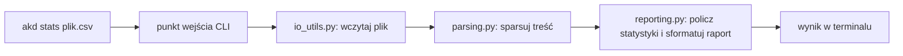

# 🧩 Weekend 3 — Capstone: `akd_cli` rozbite na moduły + type hints

> **Kurs:** AI Python Engineer
> **Blok:** Weekend 3
> **Typ pliku:** przyrost do projektu końcowego
> **Temat:** refaktor `akd_cli` na moduły, type hints w kluczowych funkcjach, świadome debugowanie
> **Główny efekt:** `akd_cli` przestaje być jednym plikiem i staje się małym, czytelnym pakietem gotowym pod testy (Weekend 4).

---

## Kontekst

Po Weekendzie 2 masz w repo `ai-knowledge-desk` działające `akd-cli` (komenda `akd stats <file>`) — płaski plik `akd_cli.py` albo mały pakiet, który wczytuje plik tekstowy/CSV i liczy statystyki (liczba linii/słów/znaków, rozkład sekcji). Ten weekend nie dodaje nowej funkcjonalności biznesowej — porządkuje to, co już działa, tak żeby dało się to bezpiecznie testować i rozwijać od Weekendu 4 w górę.

> [!IMPORTANT]
> Ten capstone dotyczy wyłącznie `ai-knowledge-desk`. Ćwiczenia z notebooków tego weekendu (`Retail Order Analyzer` w `cwiczenia_clean_w3.ipynb`) to osobny trening tych samych umiejętności na neutralnej domenie — nie przenoś ich nazw plików (`retail_order_analyzer/`, `pricing.py` liczący przychód sklepu) do projektu końcowego. Wzorzec podziału na moduły jest ten sam, nazwy modułów w `akd_cli` są inne.

---

## Co dochodzi do projektu

`akd_cli` (płaski plik lub mały pakiet z Weekendu 2) zostaje rozbite na moduły o jasno rozdzielonych odpowiedzialnościach:

| Moduł | Odpowiedzialność |
|---|---|
| `io_utils.py` | odczyt pliku wejściowego, zapis wyniku, obsługa błędów I/O (brak pliku, zły encoding) |
| `parsing.py` | parsowanie treści pliku na dane do analizy (linie, słowa, sekcje) |
| `reporting.py` | liczenie statystyk i formatowanie raportu tekstowego |
| punkt wejścia CLI (`akd_cli.py` / `akd_cli/__main__.py` — to, co już masz) | tylko odczyt argumentów i wywołanie funkcji z powyższych modułów |

Do najważniejszych funkcji w tych modułach (minimum po jednej w każdym z trzech nowych plików) dochodzą **type hints** — sygnatury mają jasno mówić, co funkcja przyjmuje i co zwraca.

Nic w zachowaniu programu się nie zmienia — `akd stats <file>` ma dawać dokładnie ten sam wynik co przed refaktorem. Zmienia się wyłącznie struktura kodu.

---

## Kroki

1. Uruchom obecne `akd-cli` i zapisz sobie wynik dla przykładowego pliku — to Twój punkt odniesienia, żeby po refaktorze sprawdzić, że nic się nie zepsuło.
2. Przejrzyj obecny kod i wypisz, które fragmenty odpowiadają za: wczytywanie pliku, parsowanie treści, liczenie statystyk, formatowanie raportu.
3. Utwórz `io_utils.py` i przenieś tam odczyt pliku (i zapis raportu do pliku, jeśli już to masz). Obsłuż tu brak pliku i błędy encodingu.
4. Utwórz `parsing.py` i przenieś tam logikę zamiany surowej treści pliku na dane gotowe do analizy (podział na linie, rozpoznawanie sekcji).
5. Utwórz `reporting.py` i przenieś tam liczenie statystyk (linie/słowa/znaki/sekcje) oraz budowanie tekstu raportu.
6. Uprość punkt wejścia CLI tak, żeby tylko odczytywał argumenty i wołał funkcje z trzech powyższych modułów — bez własnej logiki biznesowej.
7. Uruchom `akd stats <file>` ponownie i porównaj wynik z krokiem 1. Jeśli się różni, cofnij się do miejsca, gdzie przeniosłeś/przeniosłaś kod, i sprawdź, co się zmieniło.
8. Dodaj type hints do minimum 5 funkcji rozłożonych po nowych modułach (przynajmniej po jednej w `io_utils.py`, `parsing.py`, `reporting.py`).
9. Znajdź jedno miejsce, gdzie wynik może być `None` albo pusty (np. plik bez żadnej sekcji) i obsłuż to jawnie zamiast zakładać, że dane zawsze są kompletne.
10. Wybierz jeden rzeczywisty albo celowo wprowadzony błąd, znajdź go debuggerem (breakpoint, podgląd zmiennych, krokowanie) i opisz w `debug_notes.md`: objaw, przyczyna, jak to sprawdziłeś/sprawdziłaś, poprawka.
11. Opcjonalnie skorzystaj z AI jako reviewera nazw modułów i type hints — konkretnym promptem, bez proszenia o przepisanie całego kodu.

> [!TIP]
> Rób to małymi krokami: przenieś jedną funkcję, uruchom CLI, sprawdź wynik, dopiero potem przenoś kolejną. Refaktor na raz całego pliku jest trudniejszy do debugowania, jeśli coś pójdzie nie tak.

---

## Definition of Done

- [ ] `akd stats <file>` daje identyczny wynik jak przed refaktorem.
- [ ] Kod jest rozbity na `io_utils.py`, `parsing.py`, `reporting.py` — każdy plik ma jedną, jasną odpowiedzialność.
- [ ] Punkt wejścia CLI nie zawiera już logiki parsowania ani liczenia statystyk — tylko odczyt argumentów i wywołania funkcji z modułów.
- [ ] Minimum 5 funkcji w projekcie ma type hints (parametry i wartość zwracana).
- [ ] Jest przynajmniej jedno miejsce, które jawnie obsługuje brak danych / `None` / pustą sekcję.
- [ ] Powstał `debug_notes.md` z opisem jednego znalezionego i naprawionego błędu.
- [ ] Wszystkie importy między modułami są jawne (bez `from module import *`).
- [ ] Autor potrafi wyjaśnić, dlaczego dana funkcja trafiła akurat do tego modułu.

---

## Co dopisać do README

Do `README.md` projektu `ai-knowledge-desk` dopisz sekcję „Status po Weekendzie 3" z notatką, że:

- `akd_cli` zostało podzielone na moduły `io_utils.py`, `parsing.py`, `reporting.py`,
- sposób uruchomienia (`akd stats <file>`) się nie zmienił,
- kluczowe funkcje mają type hints,
- jest plik `debug_notes.md` z notatką z diagnozy błędu.

Ta sekcja przygotowuje grunt pod Weekend 4, gdzie te same moduły dostaną testy pytest i CI.
