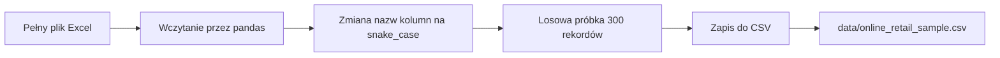
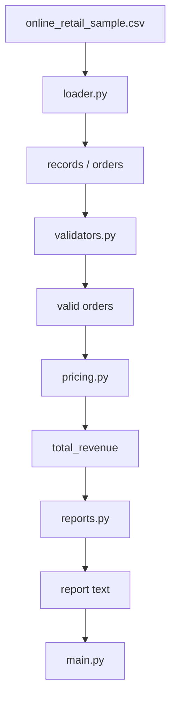

# 📊 Dataset — Online Retail / Online Retail II

> **Kurs:** AI Python Engineer  
> **Blok:** Weekend 3 — Moduły + organizacja kodu + debug  
> **Rola datasetu:** kontekst biznesowy do ćwiczeń z modułów, refaktoru, debugowania i type hints  
> **Rekomendowany plik roboczy:** `data/online_retail_sample.csv`

---

## 🧭 Po co używamy tego datasetu?

W tym bloku dataset sprzedażowy e-commerce służy jako realistyczny kontekst do ćwiczeń technicznych.

Nie skupiamy się jeszcze na zaawansowanej analizie danych ani modelach ML.  
Dane mają pomóc w praktyce:

- dzielić kod na moduły,
- refaktoryzować chaotyczny skrypt,
- debugować błędy typów i wartości,
- dodawać type hints,
- rozdzielać odpowiedzialności w kodzie,
- budować mały projekt typu **Retail Order Analyzer**.

---

## Spis treści

- [Rekomendowany wariant](#-rekomendowany-wariant)
- [Źródła danych](#-źródła-danych)
- [Który dataset wybrać?](#-który-dataset-wybrać)
- [Oczekiwane kolumny w pliku ćwiczeniowym](#-oczekiwane-kolumny-w-pliku-ćwiczeniowym)
- [Uwaga o nazwach kolumn](#-uwaga-o-nazwach-kolumn)
- [Jak przygotować próbkę CSV?](#-jak-przygotować-próbkę-csv)
- [Minimalna próbka do awaryjnego użycia](#-minimalna-próbka-do-awaryjnego-użycia)
- [Czy pełny dataset powinien być w repo?](#-czy-pełny-dataset-powinien-być-w-repo)
- [Rekomendowany `.gitignore`](#-rekomendowany-gitignore)
- [Jak dataset łączy się z ćwiczeniami?](#-jak-dataset-łączy-się-z-ćwiczeniami)

---

# ✅ Rekomendowany wariant

Na potrzeby tego bloku najlepiej użyć mniejszej próbki danych:

```text
data/online_retail_sample.csv
```

Pełny dataset jest duży, dlatego w ćwiczeniach nie potrzebujemy całego pliku.

Rekomendowana wielkość próbki:

```text
100–500 rekordów
```

Taka próbka wystarczy do:

- ćwiczeń z modułów,
- refaktoru,
- debugowania,
- walidacji danych,
- type hints,
- prostego raportowania.

> [!TIP]  
> W tym bloku ważniejsza jest struktura kodu niż wielkość danych. Mała próbka jest lepsza dydaktycznie, bo szybciej się uruchamia i łatwiej ją podejrzeć ręcznie.

---

# 🌍 Źródła danych

## Online Retail

| Element | Informacja |
|---|---|
| Nazwa | Online Retail |
| Źródło | UCI Machine Learning Repository |
| Link | [Online Retail — UCI](https://archive.ics.uci.edu/dataset/352/online+retail) |
| Zakres | transakcje od 01.12.2010 do 09.12.2011 |
| Rozmiar | ok. 541 909 rekordów |
| Rekomendacja | najlepszy wybór do tego bloku |

---

## Online Retail II

| Element | Informacja |
|---|---|
| Nazwa | Online Retail II |
| Źródło | UCI Machine Learning Repository |
| Link | [Online Retail II — UCI](https://archive.ics.uci.edu/dataset/502/online+retail+ii) |
| Zakres | transakcje od 01.12.2009 do 09.12.2011 |
| Rozmiar | ok. 1 067 371 rekordów |
| Rekomendacja | zostawić na późniejsze moduły |

---

# 🟢 Który dataset wybrać?

Do tego bloku rekomendowany jest:

```text
Online Retail
```

a nie:

```text
Online Retail II
```

## Dlaczego?

Online Retail jest:

- mniejszy,
- prostszy,
- wystarczający do ćwiczeń z organizacji kodu,
- dobry do debugowania i typowania,
- łatwiejszy do przygotowania jako próbka CSV.

Online Retail II można zostawić na późniejsze moduły, np.:

- analizę danych,
- SQL,
- segmentację klientów,
- modele ML,
- większe ćwiczenia z wydajnością,
- pracę z większym wolumenem danych.

---

# 📋 Oczekiwane kolumny w pliku ćwiczeniowym

Plik:

```text
online_retail_sample.csv
```

powinien mieć następujące kolumny:

| Kolumna | Typ w Pythonie | Opis |
|---|---:|---|
| `invoice_no` | `str` | Numer faktury lub zamówienia. |
| `stock_code` | `str` | Kod produktu. |
| `description` | `str` | Opis produktu. |
| `quantity` | `int` | Liczba sztuk. Wartości ujemne mogą oznaczać zwrot. |
| `invoice_date` | `str` | Data faktury. |
| `unit_price` | `float` | Cena jednostkowa. |
| `customer_id` | `str` / `None` | Identyfikator klienta. |
| `country` | `str` | Kraj klienta. |

---

# 🐍 Uwaga o nazwach kolumn

Oryginalny dataset może mieć nazwy kolumn w stylu `PascalCase`, np. `InvoiceNo`.

W materiałach kursowych używamy nazw w `snake_case`, bo są bardziej zgodne ze stylem Pythona.

| Oryginalna nazwa | Nazwa używana w kursie |
|---|---|
| `InvoiceNo` | `invoice_no` |
| `StockCode` | `stock_code` |
| `Description` | `description` |
| `Quantity` | `quantity` |
| `InvoiceDate` | `invoice_date` |
| `UnitPrice` | `unit_price` |
| `CustomerID` | `customer_id` |
| `Country` | `country` |

> [!IMPORTANT]  
> Ćwiczenia, przykłady kodu i type hints powinny korzystać z nazw w `snake_case`.

---

# 🛠️ Jak przygotować próbkę CSV?

Poniżej znajduje się przykładowy skrypt pomocniczy do przygotowania próbki danych.

Zakładamy, że pełny plik źródłowy znajduje się lokalnie jako:

```text
Online Retail.xlsx
```

a wynik ma zostać zapisany jako:

```text
data/online_retail_sample.csv
```

---

## Skrypt pomocniczy

```python
import pandas as pd

source_path = "Online Retail.xlsx"
output_path = "data/online_retail_sample.csv"

df = pd.read_excel(source_path)

df = df.rename(columns={
    "InvoiceNo": "invoice_no",
    "StockCode": "stock_code",
    "Description": "description",
    "Quantity": "quantity",
    "InvoiceDate": "invoice_date",
    "UnitPrice": "unit_price",
    "CustomerID": "customer_id",
    "Country": "country",
})

sample = df.sample(n=300, random_state=42)

sample.to_csv(output_path, index=False)

print(f"Saved: {output_path}")
```

---

## Co robi ten skrypt?



---

# 🧯 Minimalna próbka do awaryjnego użycia

Jeżeli pełny dataset nie jest dostępny, można stworzyć mały plik ręcznie.

Utwórz plik:

```text
data/online_retail_sample.csv
```

i wklej poniższą zawartość:

```csv
invoice_no,stock_code,description,quantity,invoice_date,unit_price,customer_id,country
536365,85123A,WHITE HANGING HEART T-LIGHT HOLDER,6,2010-12-01 08:26:00,2.55,17850,United Kingdom
536366,71053,WHITE METAL LANTERN,-1,2010-12-01 08:28:00,3.39,17850,United Kingdom
536367,84406B,CREAM CUPID HEARTS COAT HANGER,8,2010-12-01 08:34:00,0.00,17850,France
536368,84029G,KNITTED UNION FLAG HOT WATER BOTTLE,3,2010-12-01 08:34:00,3.39,,Germany
536369,22752,SET 7 BABUSHKA NESTING BOXES,2,2010-12-01 08:35:00,7.65,13047,United Kingdom
```

---

## Co zawiera próbka awaryjna?

| Rekord | Cechy dydaktyczne |
|---|---|
| `536365` | poprawna sprzedaż |
| `536366` | ujemna ilość — potencjalny zwrot |
| `536367` | cena `0.00` — przypadek do walidacji |
| `536368` | brak `customer_id` — ćwiczenie `None` / pustej wartości |
| `536369` | poprawny rekord sprzedażowy |

> [!TIP]  
> Ta próbka jest za mała do realnej analizy, ale wystarcza do awaryjnego demo modułów, walidacji, debugowania i type hints.

---

# 🚫 Czy pełny dataset powinien być w repo?

Nie zaleca się wrzucania pełnego datasetu do repozytorium kursowego.

Lepsza praktyka:

- trzymać w repo tylko małą próbkę `online_retail_sample.csv`,
- pełny plik pobierać ręcznie ze źródła,
- dodać większe dane do `.gitignore`, jeśli są używane lokalnie,
- dokumentować sposób przygotowania próbki.

---

# 🧾 Rekomendowany `.gitignore`

Przykład wpisów:

```gitignore
data/Online Retail.xlsx
data/online_retail_full.csv
data/online_retail_ii_full.csv
```

Opcjonalnie można dodać też:

```gitignore
data/*.xlsx
data/*_full.csv
```

> [!WARNING]  
> Nie ignoruj małej próbki `data/online_retail_sample.csv`, jeśli ma być częścią materiałów kursowych.

---

# 🔗 Jak dataset łączy się z ćwiczeniami?

Dataset jest używany jako kontekst do budowania małego projektu:

```text
Retail Order Analyzer
```

W ćwiczeniach uczestnicy mogą wykorzystać go do:

- wydzielenia modułu `loader.py`,
- wydzielenia modułu `validators.py`,
- wydzielenia modułu `pricing.py`,
- wydzielenia modułu `reports.py`,
- ćwiczenia importów,
- diagnozowania błędów z `quantity`, `unit_price`, `customer_id`,
- dodawania type hints,
- obsługi `None`,
- tworzenia notatki `debug_notes.md`.

---

## Przykładowy podział odpowiedzialności



---

# ✅ Minimalny efekt użycia datasetu

Po ćwiczeniach projekt powinien umieć:

- wczytać próbkę danych,
- rozpoznać rekordy niepoprawne,
- policzyć wartość poprawnych pozycji,
- odróżnić sprzedaż od zwrotu,
- obsłużyć brak `customer_id`,
- wygenerować prosty raport,
- uruchomić całość z `main.py`.

---

# 🧠 Najważniejsza zasada

Pełny dataset jest tylko tłem.

W tym bloku nie chodzi o wielką analizę danych.  
Chodzi o nauczenie się, jak organizować i debugować kod na realistycznym przykładzie biznesowym.

> [!IMPORTANT]  
> Mała, dobrze przygotowana próbka danych jest lepsza dydaktycznie niż pełny, ciężki plik.
