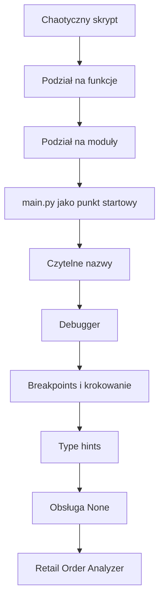
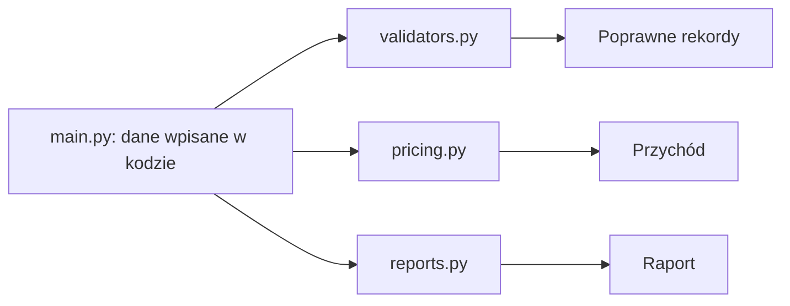
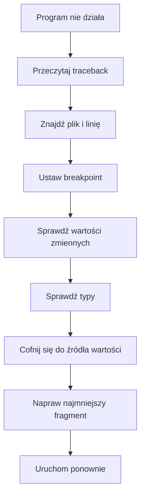

# 🧑‍🎓 Weekend 3 — Moduły + organizacja kodu + debug

> **README dla kursanta**  
> Kurs: **AI Python Engineer**  
> Blok: **Weekend 3 / 8h**  
> Temat: **moduły, organizacja kodu, debugowanie i podstawowe typowanie**  
> Główny efekt: uporządkowany mini-projekt Pythonowy gotowy do dalszej rozbudowy

---

## 🧭 O co chodzi w tym bloku?

W tym tygodniu przechodzimy od pisania pojedynczych skryptów do organizowania kodu jak w prawdziwym projekcie Pythonowym.

Do tej pory najważniejsze było to, żeby kod działał.  
Teraz dokładamy kolejny poziom:

> kod ma być czytelny, podzielony na sensowne części, łatwy do debugowania i gotowy do dalszej rozbudowy.

To bardzo ważny weekend przed wejściem w większe projekty backendowe, Django, REST API, testy i integracje z AI.

W prawdziwej pracy programista bardzo rzadko pracuje w jednym pliku. Zwykle kod jest podzielony na:

- moduły,
- funkcje,
- katalogi,
- warstwy odpowiedzialności.

---

## Spis treści

- [O co chodzi w tym bloku?](#-o-co-chodzi-w-tym-bloku)
- [Po tym weekendzie będziesz umieć](#-po-tym-weekendzie-będziesz-umieć)
- [Dlaczego to jest ważne?](#-dlaczego-to-jest-ważne)
- [Wymagania wstępne](#-wymagania-wstępne)
- [Plan weekendu](#-plan-weekendu)
  - [Sobota — organizacja kodu i moduły](#sobota--organizacja-kodu-i-moduły)
  - [Niedziela — debug i typowanie](#niedziela--debug-i-typowanie)
- [Dane używane w ćwiczeniach](#-dane-używane-w-ćwiczeniach)
- [Środowisko pracy](#️-środowisko-pracy)
- [Proponowana struktura projektu](#-proponowana-struktura-projektu)
- [Najważniejsza zasada organizacji kodu](#-najważniejsza-zasada-organizacji-kodu)
- [Funkcje vs moduły](#-funkcje-vs-moduły)
- [Importy](#-importy)
- [Clean code w praktyce](#-clean-code-w-praktyce)
- [Debugowanie](#-debugowanie)
- [Type hints](#-type-hints)
- [Jak korzystać z AI w tym bloku?](#-jak-korzystać-z-ai-w-tym-bloku)
- [Ćwiczenia w trakcie weekendu](#-ćwiczenia-w-trakcie-weekendu)
- [Mini-projekt weekendowy](#-mini-projekt-weekendowy)
- [Zadanie domowe dla chętnych](#-zadanie-domowe-dla-chętnych)
- [Jak ten blok pomaga w projekcie końcowym?](#-jak-ten-blok-pomaga-w-projekcie-końcowym)
- [Najważniejsze rzeczy do zapamiętania](#-najważniejsze-rzeczy-do-zapamiętania)
- [Praktyczna checklista przed końcem weekendu](#-praktyczna-checklista-przed-końcem-weekendu)
- [Wzorce pracy](#-wzorce-pracy)
- [Na koniec](#-na-koniec)

---

# ✅ Po tym weekendzie będziesz umieć

Po zakończeniu bloku będziesz umieć:

- wyjaśnić różnicę między funkcją, modułem i prostym projektem Pythonowym,
- podzielić większy skrypt na kilka plików,
- tworzyć i importować własne moduły,
- rozpoznawać, kiedy funkcja robi za dużo,
- poprawiać nazwy funkcji i zmiennych,
- pisać prostszy, bardziej czytelny kod,
- używać `main.py` jako punktu startowego programu,
- korzystać z `if __name__ == "__main__"`,
- czytać podstawowy traceback,
- ustawiać breakpointy,
- przechodzić przez kod krok po kroku w debuggerze,
- sprawdzać wartości zmiennych podczas działania programu,
- używać `step over`, `step into`, `step out` i `continue`,
- znaleźć źródło błędu typu, błędu z `None` albo błędu logicznego,
- dodawać podstawowe type hints do funkcji,
- typować listy, słowniki i wartości opcjonalne,
- używać `str | None`, `list[str]`, `dict[str, int]`,
- korzystać z AI jako pomocnika do refaktoru, debugowania i poprawiania czytelności kodu.

---

# 🧠 Dlaczego to jest ważne?

Kod, który działa, ale którego nie da się zrozumieć, szybko staje się problemem.

W realnej pracy:

- ktoś inny będzie czytał Twój kod,
- Ty sam/a wrócisz do swojego kodu po kilku dniach albo tygodniach,
- błędy będą się pojawiać regularnie,
- projekt będzie rósł,
- funkcje będą wykorzystywane w wielu miejscach,
- kod trzeba będzie testować,
- aplikacja będzie miała backend, bazę danych, API i integrację z AI.

Dlatego uczymy się teraz prostych nawyków:

| Nawyk | Po co? |
|---|---|
| Jedna funkcja ma jedną główną odpowiedzialność | łatwiej ją zrozumieć i przetestować |
| Jeden moduł grupuje podobne funkcje | łatwiej znaleźć właściwy kod |
| Nazwy mówią, co kod robi | mniej zgadywania |
| Debugger pomaga znaleźć przyczynę błędu | mniej chaotycznego poprawiania |
| Type hints opisują kontrakt funkcji | łatwiej rozumieć wejście i wyjście funkcji |

---

# 🧰 Wymagania wstępne

Przed tym blokiem dobrze, żebyś znał/a:

- zmienne,
- typy proste: `str`, `int`, `float`, `bool`,
- listy,
- słowniki,
- pętle,
- instrukcje warunkowe,
- podstawy funkcji,
- uruchamianie plików `.py`,
- podstawową pracę w VS Code lub PyCharm,
- podstawowe komunikaty błędów w Pythonie.

Nie musisz znać jeszcze:

- klas,
- Django,
- baz danych,
- testów,
- Docker,
- zaawansowanego typowania.

---

# 🗓️ Plan weekendu

## Sobota — organizacja kodu i moduły

W sobotę skupiamy się na tym, jak dzielić kod.

Będziemy omawiać:

- funkcje vs moduły,
- kiedy kod warto przenieść do osobnego pliku,
- jak działa `import`,
- jak budować prostą strukturę projektu,
- jak pisać czytelne funkcje,
- jak nazywać zmienne i funkcje,
- czym jest prosty clean code,
- jak refaktoryzować kod bez zmiany jego działania.

Efekt soboty:

> chaotyczny skrypt zostanie podzielony na kilka sensownych modułów.

---

## Niedziela — debug i typowanie

W niedzielę skupiamy się na diagnozowaniu błędów i dodawaniu typów.

Będziemy omawiać:

- traceback,
- breakpointy,
- krokowanie po kodzie,
- call stack,
- podgląd zmiennych,
- typowe błędy: `None`, złe typy, błędne warunki,
- type hints,
- typowanie funkcji,
- typowanie kolekcji,
- `Optional`, czyli wartości, które mogą istnieć albo nie,
- jak typowanie pomaga w debugowaniu i refaktorze.

Efekt niedzieli:

> projekt będzie czytelniejszy, łatwiejszy do debugowania i będzie miał podstawowe typowanie.

---

## Mapa weekendu



---

# 📊 Dane używane w ćwiczeniach

## Dataset

W ćwiczeniach będziemy pracować na danych sprzedażowych ze sklepu internetowego.

| Element | Opis |
|---|---|
| Nazwa datasetu | Online Retail / Online Retail II |
| Źródło | UCI Machine Learning Repository |
| Link | `https://archive.ics.uci.edu/` |
| Domena | e-commerce / retail / sprzedaż internetowa |
| Typ problemu | analiza zamówień, walidacja danych, obliczanie przychodów, raportowanie |
| Plik roboczy | brak — próbka rekordów jest wpisana wprost w komórkach notebooka |

Na zajęciach nie wczytujemy danych z pliku CSV. W notebooku (`cwiczenia_clean_w3.ipynb`) mała próbka zamówień jest wpisana wprost jako lista słowników (`orders_raw`) — celowo zawiera też kilka błędnych rekordów (ujemna ilość, zerowa cena, brak `customer_id`), żeby było na czym ćwiczyć walidację i debugowanie. Pełny opis źródłowego datasetu Online Retail (i sposób przygotowania własnej próbki CSV, jeśli chcesz poćwiczyć więcej) znajdziesz w `o_datasecie.md`.

---

## Kolumny danych

| Kolumna | Typ | Opis biznesowy |
|---|---:|---|
| `invoice_no` | `str` | Numer faktury lub zamówienia. |
| `stock_code` | `str` | Kod produktu w magazynie. |
| `description` | `str` | Nazwa lub opis produktu. |
| `quantity` | `int` | Liczba sztuk produktu w zamówieniu. Wartości ujemne mogą oznaczać zwrot. |
| `invoice_date` | `str` / `datetime` | Data i godzina faktury. |
| `unit_price` | `float` | Cena jednostkowa produktu. |
| `customer_id` | `str` / `int` / `None` | Identyfikator klienta. Może być pusty. |
| `country` | `str` | Kraj klienta lub dostawy. |

---

## Kategorie biznesowe w danych

W tym bloku nie trenujemy jeszcze modelu machine learning, więc nie mamy klasycznej etykiety do przewidywania.

Będziemy jednak pracować z kategoriami biznesowymi:

- kraj klienta,
- produkt,
- zamówienie,
- klient,
- poprawny lub niepoprawny rekord,
- sprzedaż lub potencjalny zwrot.

---

# 🖥️ Środowisko pracy

Potrzebujesz:

- Python 3.12 lub nowszy,
- VS Code albo PyCharm Community,
- terminal,
- Jupyter Notebook lub JupyterLab.

Ćwiczenia w tym bloku używają tylko biblioteki standardowej Pythona — `pandas` nie jest potrzebny do samych notebooków. Rekomendowane:

- `jupyter`.

Opcjonalnie:

- `rich`,
- `mypy`.

> [!NOTE]  
> `mypy` może się pojawić jako ciekawostka do sprawdzania typów, ale nie jest obowiązkowy na tym etapie.

---

## Instalacja środowiska — macOS / Linux

```bash
python -m venv .venv
source .venv/bin/activate
pip install jupyter
```

Uruchomienie Jupyter Notebook:

```bash
jupyter notebook
```

Uruchomienie skryptu Python:

```bash
python main.py
```

---

## Instalacja środowiska — Windows PowerShell

```powershell
python -m venv .venv
.venv\Scripts\Activate.ps1
pip install jupyter
```

Uruchomienie Jupyter Notebook:

```powershell
jupyter notebook
```

Uruchomienie skryptu Python:

```powershell
python main.py
```

---

# 🗂️ Proponowana struktura projektu

Ta struktura nie jest gotowa w repozytorium — sam/a zapiszesz ją na dysku podczas ćwiczeń w Części 2 notebooka (`cwiczenia_clean_w3.ipynb`), komórkami zapisującymi kod do plików `.py`. Dane wejściowe zostają wpisane wprost w `main.py`, więc nie ma tu osobnego pliku CSV ani modułu wczytującego dane z pliku:

```text
retail_order_analyzer/
├── main.py
├── validators.py
├── pricing.py
├── reports.py
├── debug_examples.py
└── debug_notes.md
```

---

## Co oznaczają pliki?

| Plik | Odpowiedzialność |
|---|---|
| `main.py` | główny punkt startowy programu. Dane wejściowe wpisane w kodzie, łączy kroki w jedną całość. |
| `validators.py` | sprawdzanie poprawności danych. |
| `pricing.py` | obliczanie wartości zamówień i przychodów. |
| `reports.py` | przygotowanie i wyświetlanie raportów. |
| `debug_examples.py` | kontrolowane przykłady błędów do ćwiczenia debugowania. |
| `debug_notes.md` | krótka notatka z diagnozy błędu. |

---

# 🧱 Najważniejsza zasada organizacji kodu

`main.py` powinien opowiadać historię programu na wysokim poziomie.

Przykład:

```python
from validators import filter_valid_orders
from pricing import calculate_total_revenue
from reports import print_revenue_report

orders = [
    {"invoice_no": "536365", "quantity": 6, "unit_price": 2.55, "country": "United Kingdom"},
    {"invoice_no": "536366", "quantity": -1, "unit_price": 3.39, "country": "United Kingdom"},
    # ...
]


def main() -> None:
    valid_orders = filter_valid_orders(orders)
    total_revenue = calculate_total_revenue(valid_orders)
    print_revenue_report(total_revenue)


if __name__ == "__main__":
    main()
```

Nie chodzi o to, żeby `main.py` był pusty.  
Chodzi o to, żeby nie zawierał wszystkich szczegółów naraz — dane wejściowe zostają na górze pliku jako lista, a walidacja, obliczenia i raport są w osobnych modułach.

---

## Przepływ odpowiedzialności



---

# 🧩 Funkcje vs moduły

## Funkcja

Funkcja to nazwany fragment kodu, który wykonuje konkretną operację.

Przykład:

```python
def calculate_line_total(quantity: int, unit_price: float) -> float:
    return quantity * unit_price
```

---

## Moduł

Moduł to plik `.py`, w którym grupujemy powiązane funkcje.

Przykład:

```text
pricing.py
```

W pliku `pricing.py` mogą znajdować się funkcje związane z liczeniem cen, wartości pozycji i przychodu.

---

## Proste porównanie

| Pojęcie | Co oznacza? | Przykład |
|---|---|---|
| funkcja | nazwany fragment kodu | `calculate_line_total()` |
| moduł | plik `.py` z powiązanym kodem | `pricing.py` |
| projekt | kilka modułów pracujących razem | `retail_order_analyzer/` |
| punkt wejścia | plik uruchamiający program | `main.py` |

---

# 🔌 Importy

## Przykład importu

Jeśli w pliku `pricing.py` masz funkcję:

```python
def calculate_line_total(quantity: int, unit_price: float) -> float:
    return quantity * unit_price
```

To w `main.py` możesz ją zaimportować tak:

```python
from pricing import calculate_line_total

line_total = calculate_line_total(3, 19.99)
print(line_total)
```

---

## Czego unikać przy importach?

Unikaj:

```python
from pricing import *
```

Taki import sprawia, że trudniej zrozumieć, skąd pochodzą funkcje i zmienne.

Lepiej pisać jawnie:

```python
from pricing import calculate_line_total
```

Albo:

```python
import pricing

line_total = pricing.calculate_line_total(3, 19.99)
```

---

# 🧹 Clean code w praktyce

Nie chodzi o perfekcyjny kod.  
Chodzi o kod, który można zrozumieć.

---

## Zły przykład

```python
def f(x):
    s = 0
    for i in x:
        s += i["q"] * i["p"]
    return s
```

---

## Lepszy przykład

```python
def calculate_revenue(order_items: list[dict]) -> float:
    total_revenue = 0.0

    for item in order_items:
        quantity = item["quantity"]
        unit_price = item["unit_price"]
        total_revenue += quantity * unit_price

    return total_revenue
```

Różnica:

- funkcja ma opisową nazwę,
- zmienne mają znaczenie biznesowe,
- łatwiej zrozumieć, co jest liczone,
- łatwiej znaleźć błąd.

---

## Dobre nazwy

Dobre nazwy funkcji często zaczynają się od czasownika:

- `calculate_total_revenue`,
- `validate_order`,
- `load_orders`,
- `print_report`,
- `normalize_country_name`,
- `is_return`.

Dobre nazwy zmiennych są konkretne:

- `quantity`,
- `unit_price`,
- `customer_id`,
- `country`,
- `total_revenue`,
- `order_items`.

Unikaj nazw:

- `x`,
- `y`,
- `data2`,
- `tmp`,
- `result`,
- `stuff`,
- `list1`.

> [!TIP]  
> Czasem `result` albo `data` są akceptowalne, ale na początku nauki lepiej ćwiczyć bardziej konkretne nazwy.

---

# 🐞 Debugowanie

Debugowanie to proces znajdowania przyczyny błędu.

Nie chodzi tylko o to, żeby „naprawić cokolwiek, aż zadziała”.  
Chodzi o to, żeby zrozumieć:

- co się stało,
- gdzie program się zatrzymał,
- jaka wartość była niepoprawna,
- skąd ta wartość przyszła,
- dlaczego kod zrobił coś innego niż oczekiwaliśmy.

---

## Debugowanie jako proces



---

## Traceback

Traceback to komunikat, który Python pokazuje, gdy program kończy się błędem.

Zwykle warto zacząć od ostatniej linii, np.:

```text
TypeError: can't multiply sequence by non-int of type 'float'
```

Ta linia mówi, jaki typ błędu wystąpił.

Potem patrzymy wyżej, żeby zobaczyć:

- w którym pliku pojawił się problem,
- w której linii pojawił się problem,
- jaka funkcja była wywoływana wcześniej.

---

## Breakpoint

Breakpoint to miejsce, w którym zatrzymujemy program podczas działania.

Dzięki temu możemy sprawdzić:

- wartości zmiennych,
- typy zmiennych,
- która gałąź `if` została wykonana,
- ile razy wykonała się pętla,
- z jakimi argumentami została wywołana funkcja.

---

## Najważniejsze akcje w debuggerze

| Akcja | Znaczenie |
|---|---|
| `continue` | uruchom program dalej aż do następnego breakpointa |
| `step over` | wykonaj następną linię, ale nie wchodź do środka funkcji |
| `step into` | wejdź do środka wywoływanej funkcji |
| `step out` | wyjdź z aktualnej funkcji |
| `variables` | podejrzyj aktualne wartości zmiennych |
| `call stack` | zobacz, skąd przyszło aktualne wywołanie |

---

## Typowe błędy, które będziemy diagnozować

### Błąd typu

Przykład:

```python
quantity = "5"
unit_price = 12.5

line_total = quantity * unit_price
```

Problem: `quantity` jest tekstem, a nie liczbą.

---

### Błąd z `None`

Przykład:

```python
customer_id = None

normalized_customer_id = customer_id.strip()
```

Problem: `None` nie ma metody `.strip()`.

Najpierw trzeba sprawdzić:

```python
if customer_id is None:
    normalized_customer_id = "UNKNOWN"
else:
    normalized_customer_id = customer_id.strip()
```

---

### Błąd logiczny

Przykład:

```python
def is_valid_quantity(quantity: int) -> bool:
    return quantity >= 0
```

Problem: jeśli ilość `0` nie powinna być poprawna, warunek jest zły.

Lepsza wersja:

```python
def is_valid_quantity(quantity: int) -> bool:
    return quantity > 0
```

---

# 🧾 Type hints

Type hints to podpowiedzi typów w kodzie.

Przykład bez typów:

```python
def calculate_line_total(quantity, unit_price):
    return quantity * unit_price
```

Przykład z typami:

```python
def calculate_line_total(quantity: int, unit_price: float) -> float:
    return quantity * unit_price
```

Taki zapis mówi:

- `quantity` powinno być liczbą całkowitą,
- `unit_price` powinno być liczbą zmiennoprzecinkową,
- funkcja zwraca `float`.

---

## Ważne: type hints nie są automatyczną walidacją

Ten kod może się nadal uruchomić, nawet jeśli przekażemy zły typ:

```python
def calculate_line_total(quantity: int, unit_price: float) -> float:
    return quantity * unit_price


print(calculate_line_total("5", 12.5))
```

Type hints pomagają:

- człowiekowi,
- edytorowi,
- narzędziom,
- AI,
- przyszłemu Tobie.

Ale same z siebie nie zawsze zatrzymają program podczas działania.

---

## Typowanie kolekcji

Lista tekstów:

```python
countries: list[str] = ["United Kingdom", "Germany", "France"]
```

Lista liczb:

```python
quantities: list[int] = [1, 2, 3, 10]
```

Słownik:

```python
order: dict[str, str | int | float] = {
    "invoice_no": "536365",
    "quantity": 6,
    "unit_price": 2.55,
}
```

Lista słowników:

```python
orders: list[dict[str, str | int | float]] = [
    {
        "invoice_no": "536365",
        "quantity": 6,
        "unit_price": 2.55,
    }
]
```

Nie musisz od razu typować wszystkiego idealnie.  
Na początku celem jest większa czytelność.

---

## `Optional`, czyli wartość albo brak wartości

W nowoczesnym Pythonie często zapisujemy to tak:

```python
def find_customer_country(customer_id: str) -> str | None:
    if customer_id == "":
        return None

    return "United Kingdom"
```

`str | None` oznacza:

- funkcja może zwrócić tekst,
- albo może zwrócić `None`.

To ważna informacja dla osoby, która używa tej funkcji.

Kod wywołujący powinien sprawdzić wynik:

```python
country = find_customer_country("123")

if country is None:
    print("Country is unknown")
else:
    print(country.upper())
```

---

# 🤖 Jak korzystać z AI w tym bloku?

AI może pomóc, ale nie powinno zastępować Twojego myślenia.

Dobre zastosowania AI:

- sprawdzenie nazw funkcji,
- propozycja podziału dużej funkcji,
- wyjaśnienie tracebacka,
- wskazanie możliwych przyczyn błędu,
- dodanie type hints,
- wygenerowanie prostych przypadków testowych do ręcznego sprawdzenia.

---

## Dobry prompt do AI — review nazw

```text
Sprawdź poniższy kod jako reviewer Pythona dla początkującego juniora.
Skup się tylko na nazwach funkcji, nazwach zmiennych i odpowiedzialnościach.
Nie zmieniaj logiki biznesowej.
Zaproponuj maksymalnie 5 konkretnych poprawek.
```

---

## Dobry prompt do AI — debugowanie

```text
Mam poniższy traceback i fragment kodu.
Pomóż mi znaleźć najbardziej prawdopodobną przyczynę błędu.
Nie podawaj pełnego rozwiązania.
Podaj 3 hipotezy i napisz, jak mogę sprawdzić każdą z nich w debuggerze.
```

---

## Dobry prompt do AI — typowanie

```text
Dodaj type hints do poniższych funkcji.
Nie zmieniaj logiki.
Jeśli typ jest niepewny, wyjaśnij dlaczego.
Używaj prostych typów odpowiednich dla osoby początkującej.
```

---

## Zły prompt do AI

```text
Napraw mi cały projekt.
```

Taki prompt jest zbyt ogólny. AI może przepisać dużo kodu naraz, dodać rzeczy, których jeszcze nie znasz, i utrudnić naukę.

Lepsza strategia:

- pytaj o mały fragment,
- dokładnie opisz problem,
- poproś o wyjaśnienie,
- samodzielnie zdecyduj, które sugestie przyjmujesz.

---

# 🧪 Ćwiczenia w trakcie weekendu

W ćwiczeniach będziesz między innymi:

1. analizować chaotyczny skrypt,
2. wskazywać odpowiedzialności fragmentów kodu,
3. wydzielać funkcje,
4. tworzyć moduły,
5. poprawiać nazwy,
6. usuwać duplikację,
7. przenosić logikę do `validators.py`, `pricing.py` i `reports.py`,
8. porządkować `main.py`,
9. używać AI do krótkiego review,
10. czytać traceback,
11. ustawiać breakpointy,
12. przechodzić przez kod krok po kroku,
13. diagnozować błąd typu,
14. diagnozować błąd z `None`,
15. diagnozować błąd logiczny,
16. dodawać type hints,
17. typować listy i słowniki,
18. używać `str | None`,
19. łączyć debugowanie z typowaniem,
20. przygotować mini-projekt `Retail Order Analyzer`.

---

# 🧩 Mini-projekt weekendowy

Na koniec weekendu Twoim zadaniem będzie uporządkować mały projekt analizujący zamówienia sklepu internetowego.

Minimalny efekt:

- projekt ma kilka plików,
- `main.py` uruchamia program,
- walidacja danych jest w osobnym module,
- obliczenia są w osobnym module,
- raportowanie jest w osobnym module,
- najważniejsze funkcje mają type hints,
- jeden błąd został znaleziony z użyciem debuggera,
- masz krótką notatkę opisującą objaw, przyczynę i poprawkę.

---

## Przykładowa notatka z debugowania

```markdown
# Debug note

## Objaw
Program błędnie liczył wartość zamówienia dla jednego rekordu.

## Przyczyna
Pole `quantity` zostało wczytane jako tekst, a funkcja `calculate_line_total` oczekiwała liczby całkowitej.

## Poprawka
Dodałem konwersję `quantity` do `int` podczas wczytywania danych oraz type hint `quantity: int`.
```

---

# 🏠 Zadanie domowe dla chętnych

Rozbuduj swój projekt końcowy po weekendzie.

Wybierz jeden fragment kodu, który masz obecnie w jednym pliku, i podziel go na moduły.

Minimalne wymagania:

1. Utwórz `main.py` jako punkt wejścia.
2. Wydziel przynajmniej dwa moduły pomocnicze.
3. Dodaj type hints do minimum pięciu funkcji.
4. Znajdź jeden potencjalny błąd z użyciem debuggera.
5. Opisz ten błąd w pliku `debug_notes.md`.

Przykładowa struktura:

```text
my_project/
├── main.py
├── validators.py
├── services.py
├── formatters.py
└── debug_notes.md
```

---

# 🏁 Jak ten blok pomaga w projekcie końcowym?

Po tym weekendzie Twój projekt końcowy powinien być lepiej zorganizowany.

To przygotowuje Cię do kolejnych tematów:

| Kolejny temat | Jak pomaga Weekend 3? |
|---|---|
| testy jednostkowe | małe funkcje łatwiej testować |
| Django | Django też ma strukturę plików i odpowiedzialności |
| REST API | walidacja, logika i odpowiedź API powinny być rozdzielone |
| integracja z AI | kod komunikujący się z modelem może być w osobnym miejscu |
| debugowanie backendu | łatwiej szukać przyczyny błędu krok po kroku |

---

# 🧠 Najważniejsze rzeczy do zapamiętania

1. Funkcja powinna mieć jedną główną odpowiedzialność.
2. Moduł to plik grupujący podobne funkcje.
3. `main.py` powinien pokazywać główny przebieg programu.
4. Dobre nazwy są częścią dokumentacji kodu.
5. Refaktor powinien zmieniać strukturę, a nie przypadkowo logikę.
6. Traceback pokazuje, gdzie program się wywrócił.
7. Debugger pozwala zobaczyć, co dzieje się w trakcie działania programu.
8. Type hints opisują, jakich danych oczekuje funkcja i co zwraca.
9. `None` trzeba obsługiwać jawnie.
10. AI jest pomocnikiem, nie zastępstwem za rozumienie kodu.

---

# ✅ Praktyczna checklista przed końcem weekendu

Sprawdź, czy potrafisz:

- [ ] uruchomić projekt z `main.py`,
- [ ] zaimportować funkcję z własnego modułu,
- [ ] wyjaśnić, za co odpowiada każdy plik w projekcie,
- [ ] poprawić nazwę nieczytelnej funkcji,
- [ ] wydzielić prostą funkcję pomocniczą,
- [ ] ustawić breakpoint,
- [ ] przejść przez funkcję krok po kroku,
- [ ] sprawdzić typ zmiennej w debuggerze,
- [ ] znaleźć błąd z `None`,
- [ ] dodać type hints do funkcji,
- [ ] zapisać typ `str | None`,
- [ ] wyjaśnić, dlaczego typowanie pomaga w refaktorze.

---

# 🔁 Wzorce pracy

## Najprostszy wzorzec pracy przy błędzie

Gdy kod nie działa:

1. Przeczytaj ostatnią linię tracebacka.
2. Sprawdź plik i numer linii błędu.
3. Ustaw breakpoint kilka linii wcześniej.
4. Uruchom program w debuggerze.
5. Sprawdź wartości i typy zmiennych.
6. Cofnij się mentalnie: skąd przyszła błędna wartość?
7. Napraw najmniejszy możliwy fragment.
8. Uruchom program ponownie.
9. Opisz przyczynę błędu jednym zdaniem.

---

## Najprostszy wzorzec pracy przy refaktorze

Gdy chcesz uporządkować kod:

1. Najpierw uruchom kod i upewnij się, że działa.
2. Znajdź fragmenty o różnych odpowiedzialnościach.
3. Wydziel małą funkcję.
4. Uruchom kod ponownie.
5. Przenieś funkcję do modułu.
6. Dodaj import.
7. Uruchom kod ponownie.
8. Popraw nazwę.
9. Dodaj type hints.
10. Uruchom kod ponownie.

> [!IMPORTANT]  
> Nie rób dziesięciu dużych zmian naraz. Małe kroki są bezpieczniejsze.

---

# 💬 Na koniec

Ten weekend może wydawać się mniej spektakularny niż budowanie nowej funkcjonalności, ale to jeden z najważniejszych kroków w stronę pracy jako junior Python / backend developer.

Profesjonalny kod to nie tylko kod, który działa.

Profesjonalny kod to kod, który można:

- przeczytać,
- zrozumieć,
- uruchomić,
- zdebugować,
- przetestować,
- rozbudować.

> [!IMPORTANT]  
> Tego właśnie uczymy się w tym bloku.
