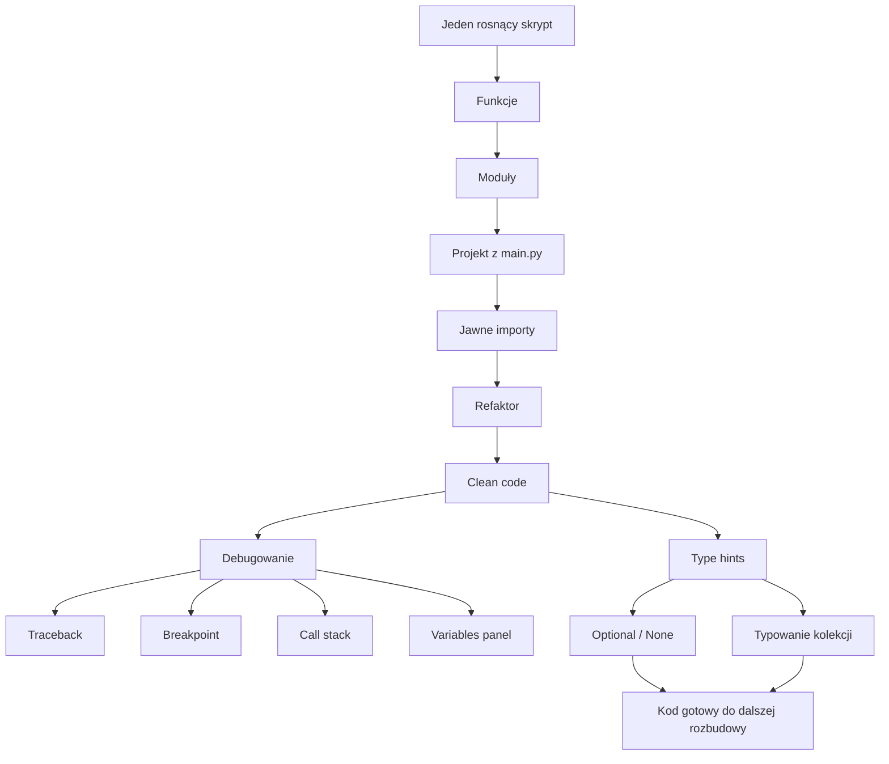
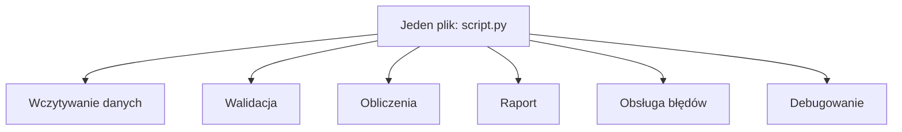
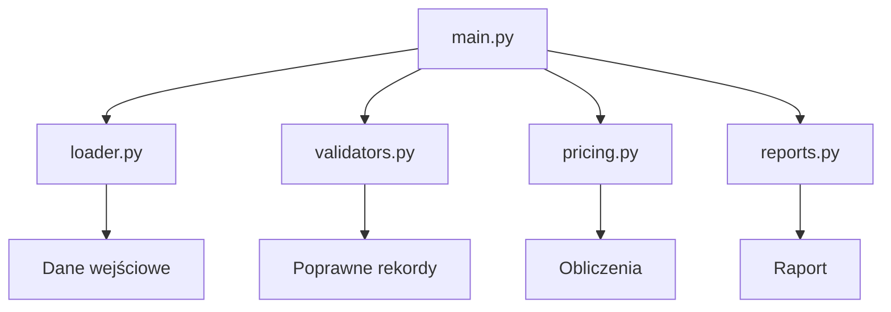
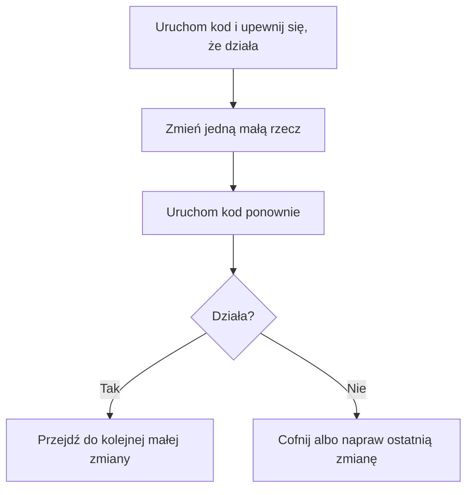
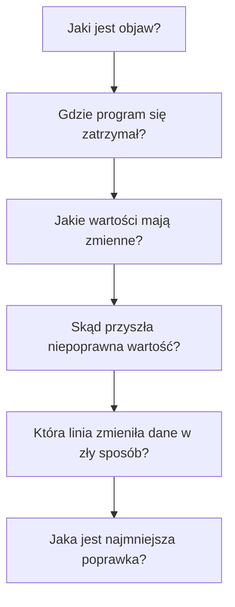
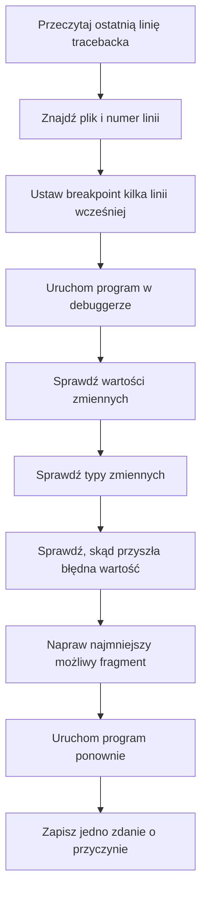

# 📚 Weekend 3 - Moduły + organizacja kodu + debug

> **Teoria do bloku**  
> Kurs: **AI Python Engineer**  
> Temat: **moduły, organizacja kodu, refaktor, debugowanie i type hints**  
> Poziom: **2/5**  
> Cel: przejście od pojedynczych skryptów do małego, czytelnego projektu Pythonowego

---

## 🧭 O czym jest ta teoria?

W tym bloku uczymy się pisać kod, który jest bliżej realnej pracy programisty.

Nie chodzi już tylko o to, żeby program zadziałał raz na Twoim komputerze.  
Chodzi o to, żeby kod można było:

- przeczytać,
- zrozumieć,
- podzielić na odpowiedzialności,
- uruchomić,
- zdebugować,
- poprawić,
- rozbudować,
- przygotować do testów i backendu.

To fundament dalszej części kursu: testów, Django, REST API, baz danych, integracji z AI i deploymentu.

---

## Spis treści

- [O czym jest ta teoria?](#-o-czym-jest-ta-teoria)
- [Mapa bloku](#-mapa-bloku)
- [1. Po co organizować kod?](#1-po-co-organizować-kod)
- [2. Funkcja](#2-funkcja)
- [3. Moduł](#3-moduł)
- [4. Pakiet i projekt](#4-pakiet-i-projekt)
- [5. Przykładowa struktura małego projektu](#5-przykładowa-struktura-małego-projektu)
- [6. Importy](#6-importy)
- [7. `import module` vs `from module import function`](#7-import-module-vs-from-module-import-function)
- [8. Czego unikać przy importach?](#8-czego-unikać-przy-importach)
- [9. `if __name__ == "__main__"`](#9-if-__name__--__main__)
- [10. Odpowiedzialność kodu](#10-odpowiedzialność-kodu)
- [11. Refaktor](#11-refaktor)
- [12. Clean code dla początkujących](#12-clean-code-dla-początkujących)
- [13. Dobre nazwy funkcji](#13-dobre-nazwy-funkcji)
- [14. Dobre nazwy zmiennych](#14-dobre-nazwy-zmiennych)
- [15. Stałe zamiast magic numbers](#15-stałe-zamiast-magic-numbers)
- [16. Duplikacja kodu](#16-duplikacja-kodu)
- [17. Debugowanie](#17-debugowanie)
- [18. Typy błędów](#18-typy-błędów)
- [19. Traceback](#19-traceback)
- [20. Breakpoint](#20-breakpoint)
- [21. Krokowanie po kodzie](#21-krokowanie-po-kodzie)
- [22. Variables panel](#22-variables-panel)
- [23. Call stack](#23-call-stack)
- [24. Debugowanie błędu typu](#24-debugowanie-błędu-typu)
- [25. Debugowanie błędu `None`](#25-debugowanie-błędu-none)
- [26. Debugowanie błędu logicznego](#26-debugowanie-błędu-logicznego)
- [27. Type hints](#27-type-hints)
- [28. Type hints nie są automatyczną walidacją runtime](#28-type-hints-nie-są-automatyczną-walidacją-runtime)
- [29. Typowanie wartości prostych](#29-typowanie-wartości-prostych)
- [30. Typowanie list](#30-typowanie-list)
- [31. Typowanie słowników](#31-typowanie-słowników)
- [32. Typowanie listy słowników](#32-typowanie-listy-słowników)
- [33. `Optional` i `None`](#33-optional-i-none)
- [34. `Any`](#34-any)
- [35. Type alias](#35-type-alias)
- [36. Typowanie a refaktor](#36-typowanie-a-refaktor)
- [37. Typowanie a debugowanie](#37-typowanie-a-debugowanie)
- [38. Minimalny proces diagnozy błędu](#38-minimalny-proces-diagnozy-błędu)
- [39. Minimalny proces refaktoru](#39-minimalny-proces-refaktoru)
- [40. AI jako pomocnik](#40-ai-jako-pomocnik)
- [41. Dane w tym bloku](#41-dane-w-tym-bloku)
- [42. Przykład: kod przed refaktorem](#42-przykład-kod-przed-refaktorem)
- [43. Przykład: kod po refaktorze](#43-przykład-kod-po-refaktorze)
- [44. Jak to przygotowuje do Django?](#44-jak-to-przygotowuje-do-django)
- [45. Najważniejsze zasady do zapamiętania](#45-najważniejsze-zasady-do-zapamiętania)
- [46. Szybka ściąga](#46-szybka-ściąga)
- [47. Podsumowanie](#47-podsumowanie)

---

## 🗺️ Mapa bloku



---

# 1. Po co organizować kod?

Na początku nauki często piszemy kod w jednym pliku. To jest normalne i dobre na start.

Problem zaczyna się wtedy, gdy plik rośnie:

- trudno znaleźć konkretną funkcję,
- trudno zrozumieć, gdzie zaczyna się logika biznesowa,
- łatwo przypadkiem zmienić coś, czego nie chcieliśmy zmieniać,
- debugowanie robi się chaotyczne,
- przyszłe testowanie kodu jest trudniejsze,
- współpraca z innymi programistami staje się męcząca.

W realnej pracy backend developera kod jest dzielony na pliki, katalogi i warstwy odpowiedzialności.

Nawet prosta aplikacja zwykle ma osobno:

- punkt wejścia programu,
- walidację danych,
- logikę biznesową,
- obsługę plików albo bazy danych,
- formatowanie odpowiedzi,
- testy.

W tym bloku uczymy się podstaw tego podejścia na zwykłym Pythonie, zanim pojawią się Django, REST API, baza danych i Docker.

---

## Problem jednego dużego pliku



W małym przykładzie to jeszcze działa.  
W większym projekcie robi się nieczytelne.

Lepszy kierunek:



---

# 2. Funkcja

Funkcja to nazwany fragment kodu, który wykonuje konkretną operację.

Przykład:

```python
def calculate_line_total(quantity: int, unit_price: float) -> float:
    return quantity * unit_price
```

Ta funkcja:

- przyjmuje `quantity`,
- przyjmuje `unit_price`,
- zwraca wartość pozycji zamówienia.

Dobra funkcja powinna być możliwie prosta do opisania jednym zdaniem.

Dobry opis:

> Funkcja liczy wartość jednej pozycji zamówienia.

Sygnał ostrzegawczy:

> Funkcja wczytuje dane, czyści je, liczy raport, drukuje wynik i zapisuje plik.

To prawdopodobnie za dużo jak na jedną funkcję.

---

## Funkcja o jasnej odpowiedzialności

```python
def is_valid_quantity(quantity: int) -> bool:
    return quantity > 0
```

Ta funkcja robi jedną rzecz: sprawdza, czy ilość jest poprawna.

---

## Funkcja, która robi za dużo

```python
def process_orders(path):
    data = open(path).read()
    rows = data.splitlines()
    total = 0

    for row in rows:
        parts = row.split(",")
        quantity = int(parts[3])
        price = float(parts[5])

        if quantity > 0 and price > 0:
            total += quantity * price

    print("Total:", total)
```

Ta funkcja:

- otwiera plik,
- parsuje dane,
- waliduje dane,
- liczy wynik,
- drukuje raport.

Lepiej podzielić ją na kilka mniejszych funkcji.

---

# 3. Moduł

Moduł w Pythonie to plik `.py`.

Jeśli mamy plik:

```text
pricing.py
```

to `pricing` jest modułem.

W module możemy umieścić funkcje, stałe i zmienne związane z jednym obszarem odpowiedzialności.

---

## Przykład modułu `pricing.py`

```python
def calculate_line_total(quantity: int, unit_price: float) -> float:
    return quantity * unit_price


def calculate_total_revenue(items: list[dict]) -> float:
    total_revenue = 0.0

    for item in items:
        total_revenue += calculate_line_total(
            item["quantity"],
            item["unit_price"],
        )

    return total_revenue
```

Ten moduł zajmuje się liczeniem cen i przychodu.  
Nie powinien jednocześnie odpowiadać za wczytywanie pliku CSV, drukowanie raportu i rozmowę z użytkownikiem.

---

# 4. Pakiet i projekt

Pakiet to katalog zawierający moduły.

Przykład:

```text
retail_order_analyzer/
├── main.py
├── loader.py
├── validators.py
├── pricing.py
└── reports.py
```

Na tym etapie wystarczy rozumieć, że:

- moduł to pojedynczy plik `.py`,
- projekt może składać się z wielu modułów,
- każdy moduł powinien mieć sensowną odpowiedzialność.

> [!NOTE]  
> W późniejszych etapach kursu pojawią się bardziej rozbudowane pakiety, katalogi i struktury projektów.

---

# 5. Przykładowa struktura małego projektu

Dla projektu analizującego zamówienia sklepu internetowego możemy użyć takiej struktury:

```text
retail_order_analyzer/
├── main.py
├── loader.py
├── validators.py
├── pricing.py
├── reports.py
├── debug_examples.py
└── data/
    └── online_retail_sample.csv
```

## Znaczenie plików

| Plik | Odpowiedzialność |
|---|---|
| `main.py` | Główny punkt wejścia programu. Łączy całość w jeden proces. |
| `loader.py` | Wczytuje dane z pliku. |
| `validators.py` | Sprawdza poprawność danych. |
| `pricing.py` | Liczy wartości pozycji, zamówień i przychody. |
| `reports.py` | Przygotowuje i wyświetla raporty. |
| `debug_examples.py` | Zawiera przykłady błędów do ćwiczenia debugowania. |
| `data/` | Przechowuje dane wejściowe. |

Najważniejsza zasada:

> `main.py` powinien być czytelny jak spis kroków.

---

## Przykład `main.py`

```python
from loader import load_orders
from validators import filter_valid_orders
from pricing import calculate_total_revenue
from reports import print_revenue_report


def main() -> None:
    orders = load_orders("data/online_retail_sample.csv")
    valid_orders = filter_valid_orders(orders)
    total_revenue = calculate_total_revenue(valid_orders)
    print_revenue_report(total_revenue)


if __name__ == "__main__":
    main()
```

Po przeczytaniu tej funkcji widać główny przebieg programu:

1. Wczytaj zamówienia.
2. Odfiltruj poprawne rekordy.
3. Policz przychód.
4. Wydrukuj raport.

Szczegóły są ukryte w odpowiednich modułach.

---

# 6. Importy

Import pozwala używać kodu z innego pliku.

Załóżmy, że w pliku `pricing.py` mamy:

```python
def calculate_line_total(quantity: int, unit_price: float) -> float:
    return quantity * unit_price
```

W pliku `main.py` możemy zaimportować tę funkcję:

```python
from pricing import calculate_line_total

line_total = calculate_line_total(3, 19.99)
print(line_total)
```

Możemy też zaimportować cały moduł:

```python
import pricing

line_total = pricing.calculate_line_total(3, 19.99)
print(line_total)
```

Obie wersje są poprawne.

---

# 7. `import module` vs `from module import function`

## Wariant 1: import całego modułu

```python
import pricing

total = pricing.calculate_line_total(2, 10.0)
```

Zaleta:

- od razu widać, że funkcja pochodzi z modułu `pricing`.

Wada:

- zapis jest trochę dłuższy.

---

## Wariant 2: import konkretnej funkcji

```python
from pricing import calculate_line_total

total = calculate_line_total(2, 10.0)
```

Zaleta:

- kod jest krótszy.

Wada:

- przy wielu importach może być mniej jasne, skąd pochodzi dana funkcja.

Oba style są spotykane. Najważniejsze, żeby zespół był konsekwentny.

---

# 8. Czego unikać przy importach?

Unikaj:

```python
from pricing import *
```

Taki import oznacza:

> zaimportuj wszystko z modułu `pricing`.

Problem:

- nie widać, skąd pochodzą funkcje,
- łatwo nadpisać nazwę,
- trudniej debugować,
- kod jest mniej czytelny.

Lepiej pisać jawnie:

```python
from pricing import calculate_line_total
```

albo:

```python
import pricing
```

---

# 9. `if __name__ == "__main__"`

Ten zapis często pojawia się w pliku uruchamianym jako główny program.

Przykład:

```python
def main() -> None:
    print("Start programu")


if __name__ == "__main__":
    main()
```

Intuicyjnie oznacza to:

> Uruchom funkcję `main()` tylko wtedy, gdy ten plik został uruchomiony bezpośrednio.

Dzięki temu plik może być:

- uruchomiony jako program,
- zaimportowany w innym pliku bez automatycznego wykonywania całego kodu.

---

## Problem bez tego zabezpieczenia

```python
print("Ten kod wykona się od razu przy imporcie")
```

Jeśli taki plik zostanie zaimportowany, `print()` uruchomi się automatycznie.

Czasami tego chcemy, ale w większych projektach zwykle wolimy mieć większą kontrolę.

---

# 10. Odpowiedzialność kodu

Odpowiedzialność to odpowiedź na pytanie:

> Za co odpowiada ten fragment kodu?

Przykłady odpowiedzialności:

- wczytanie danych,
- sprawdzenie poprawności danych,
- obliczenie wartości zamówienia,
- przygotowanie raportu,
- wyświetlenie wyniku,
- obsługa błędu.

Dobra funkcja ma jedną główną odpowiedzialność.

---

## Przykład funkcji o jasnej odpowiedzialności

```python
def is_valid_quantity(quantity: int) -> bool:
    return quantity > 0
```

Funkcja odpowiada za jedną rzecz: sprawdza, czy ilość jest poprawna.

---

## Przykład funkcji zbyt dużej

```python
def process_orders(path):
    data = open(path).read()
    rows = data.splitlines()
    total = 0

    for row in rows:
        parts = row.split(",")
        quantity = int(parts[3])
        price = float(parts[5])

        if quantity > 0 and price > 0:
            total += quantity * price

    print("Total:", total)
```

Ta funkcja:

- otwiera plik,
- parsuje dane,
- waliduje dane,
- liczy wynik,
- drukuje raport.

Lepiej podzielić ją na kilka mniejszych funkcji.

---

# 11. Refaktor

Refaktor to zmiana struktury kodu bez zmiany jego zachowania.

Przykłady refaktoru:

- zmiana nazwy funkcji,
- wydzielenie fragmentu do osobnej funkcji,
- przeniesienie funkcji do innego modułu,
- usunięcie duplikacji,
- uproszczenie warunku.

Refaktor nie powinien przypadkowo zmieniać logiki biznesowej.

---

## Bezpieczny proces refaktoru



Nie rób dziesięciu dużych zmian naraz.  
Gdy coś się zepsuje, trudno będzie znaleźć przyczynę.

---

# 12. Clean code dla początkujących

Clean code to nie zestaw magicznych reguł.  
To kod, który da się zrozumieć, zmienić i zdebugować.

Na tym etapie najważniejsze są cztery zasady:

| Zasada | Co oznacza w praktyce? |
|---|---|
| Używaj dobrych nazw | nazwa mówi, co robi kod |
| Pisz małe funkcje o jasnej odpowiedzialności | funkcja robi jedną główną rzecz |
| Unikaj duplikacji | wspólną logikę przenieś do funkcji |
| Nie komplikuj bez potrzeby | proste rozwiązanie jest często najlepsze |

---

# 13. Dobre nazwy funkcji

Funkcja zwykle wykonuje akcję, dlatego jej nazwa często zaczyna się od czasownika.

Dobre przykłady:

- `load_orders`,
- `validate_order`,
- `calculate_line_total`,
- `calculate_total_revenue`,
- `normalize_country_name`,
- `print_revenue_report`,
- `is_valid_quantity`,
- `is_return`.

Słabsze przykłady:

- `do_stuff`,
- `process`,
- `handle`,
- `func1`,
- `run_data`,
- `calculate`.

Nie każda krótka nazwa jest zła, ale na początku nauki warto ćwiczyć konkretne nazwy.

---

# 14. Dobre nazwy zmiennych

Zmienna powinna mówić, co przechowuje.

Słabe nazwy:

```python
q = 5
p = 12.5
s = q * p
```

Lepsze nazwy:

```python
quantity = 5
unit_price = 12.5
line_total = quantity * unit_price
```

Różnica jest ogromna.  
W drugim przykładzie nie trzeba zgadywać, co oznaczają dane.

W kodzie biznesowym używaj pojęć z domeny:

- `invoice_no`,
- `customer_id`,
- `country`,
- `quantity`,
- `unit_price`,
- `total_revenue`,
- `order_items`.

---

# 15. Stałe zamiast magic numbers

Magic number to liczba wpisana bez wyjaśnienia bezpośrednio w kodzie.

Przykład:

```python
if order_value > 250:
    print("Free shipping")
```

Lepsza wersja:

```python
FREE_SHIPPING_THRESHOLD = 250

if order_value > FREE_SHIPPING_THRESHOLD:
    print("Free shipping")
```

Stałe zwykle zapisujemy wielkimi literami:

```python
MIN_VALID_QUANTITY = 1
DEFAULT_COUNTRY = "Unknown"
FREE_SHIPPING_THRESHOLD = 250
```

---

# 16. Duplikacja kodu

Duplikacja oznacza, że ten sam lub bardzo podobny kod pojawia się w kilku miejscach.

Przykład:

```python
line_total_1 = quantity_1 * unit_price_1
line_total_2 = quantity_2 * unit_price_2
line_total_3 = quantity_3 * unit_price_3
```

Lepsza wersja:

```python
def calculate_line_total(quantity: int, unit_price: float) -> float:
    return quantity * unit_price


line_total_1 = calculate_line_total(quantity_1, unit_price_1)
line_total_2 = calculate_line_total(quantity_2, unit_price_2)
line_total_3 = calculate_line_total(quantity_3, unit_price_3)
```

Korzyść:

- logika jest w jednym miejscu,
- łatwiej ją poprawić,
- łatwiej ją przetestować,
- łatwiej ją nazwać i zrozumieć.

---

# 17. Debugowanie

Debugowanie to proces znajdowania przyczyny błędu.

Błąd może oznaczać:

- program się nie uruchamia,
- program kończy się wyjątkiem,
- program działa, ale daje zły wynik,
- program działa tylko dla części danych,
- program zachowuje się inaczej, niż oczekiwaliśmy.

Debugowanie nie polega na losowym zmienianiu kodu.

Dobre debugowanie przypomina śledztwo:



---

# 18. Typy błędów

## Błąd składniowy

Python nie rozumie kodu.

Przykład:

```python
def calculate_total(
    return 10
```

Taki kod nie uruchomi się, bo składnia jest niepoprawna.

---

## Błąd runtime

Kod ma poprawną składnię, ale psuje się podczas działania.

Przykład:

```python
quantity = "5"
unit_price = 12.5

line_total = quantity * unit_price
```

Problem pojawia się dopiero w czasie wykonywania programu.

---

## Błąd logiczny

Program działa, ale wynik jest zły.

Przykład:

```python
def is_valid_quantity(quantity: int) -> bool:
    return quantity >= 0
```

Jeśli w biznesie ilość `0` nie powinna być poprawna, to kod zawiera błąd logiczny.

Program się nie wywróci, ale wynik będzie niezgodny z oczekiwaniem.

---

# 19. Traceback

Traceback to komunikat błędu pokazany przez Pythona.

Przykład:

```text
Traceback (most recent call last):
  File "main.py", line 8, in <module>
    total = calculate_line_total(quantity, unit_price)
  File "pricing.py", line 2, in calculate_line_total
    return quantity * unit_price
TypeError: can't multiply sequence by non-int of type 'float'
```

Jak czytać traceback?

1. Zacznij od ostatniej linii.
2. Sprawdź typ błędu.
3. Sprawdź komunikat.
4. Popatrz wyżej, w którym pliku i linii doszło do błędu.
5. Nie zakładaj od razu, że ostatnia linia jest prawdziwą przyczyną.

W tym przykładzie objaw jest w `pricing.py`, ale przyczyna może być wcześniej: `quantity` mogło zostać wczytane jako tekst.

---

# 20. Breakpoint

Breakpoint to miejsce, w którym zatrzymujemy program podczas działania.

Dzięki breakpointowi możemy zobaczyć:

- wartości zmiennych,
- typy zmiennych,
- aktualną linię kodu,
- ścieżkę wykonania programu,
- argumenty funkcji,
- wynik warunku `if`.

Przykład miejsca, gdzie warto ustawić breakpoint:

```python
def calculate_line_total(quantity: int, unit_price: float) -> float:
    return quantity * unit_price
```

Jeśli wynik jest zły, zatrzymaj program przed `return` i sprawdź:

- ile wynosi `quantity`,
- ile wynosi `unit_price`,
- czy typy są zgodne z oczekiwaniem.

---

# 21. Krokowanie po kodzie

Debugger pozwala wykonywać kod krok po kroku.

Najważniejsze akcje:

| Akcja | Znaczenie |
|---|---|
| `continue` | Kontynuuj działanie programu do następnego breakpointa. |
| `step over` | Wykonaj następną linię, ale nie wchodź do środka funkcji. |
| `step into` | Wejdź do środka wywoływanej funkcji. |
| `step out` | Wyjdź z aktualnej funkcji. |
| `restart` | Uruchom debugowanie od nowa. |
| `stop` | Zatrzymaj debugowanie. |

Praktyczna zasada:

- użyj `step over`, gdy funkcja Cię teraz nie interesuje,
- użyj `step into`, gdy podejrzewasz, że błąd jest wewnątrz funkcji,
- użyj `step out`, gdy wszedłeś za głęboko.

---

# 22. Variables panel

Panel zmiennych pokazuje aktualny stan programu.

Możesz tam zobaczyć:

- zmienne lokalne,
- argumenty funkcji,
- wartości list i słowników,
- typy danych,
- wartości `None`.

To bardzo przydatne, gdy program działa inaczej, niż oczekujesz.

Przykład:

```python
def normalize_customer_id(customer_id: str | None) -> str:
    return customer_id.strip()
```

Jeśli `customer_id` wynosi `None`, debugger pokaże to przed wykonaniem błędnej linii.

---

# 23. Call stack

Call stack pokazuje, jakie funkcje doprowadziły program do aktualnego miejsca.

Przykład:

```text
main()
  generate_report()
    calculate_total_revenue()
      calculate_line_total()
```

Jeśli jesteś w `calculate_line_total`, call stack pozwala sprawdzić:

- kto wywołał tę funkcję,
- z jakiego miejsca przyszły dane,
- jaką drogą program dotarł do błędu.

To ważne, bo miejsce awarii nie zawsze jest miejscem pierwotnej przyczyny.

---

# 24. Debugowanie błędu typu

Przykład:

```python
def calculate_line_total(quantity: int, unit_price: float) -> float:
    return quantity * unit_price


quantity = "5"
unit_price = 12.5

print(calculate_line_total(quantity, unit_price))
```

Funkcja oczekuje `int`, ale dostaje `str`.

Jak debugować?

1. Ustaw breakpoint przed wywołaniem funkcji.
2. Sprawdź wartość `quantity`.
3. Sprawdź typ `quantity`.
4. Znajdź miejsce, gdzie `quantity` zostało wczytane.
5. Zdecyduj, czy należy dodać konwersję, walidację czy poprawić dane.

Możliwa poprawka:

```python
quantity = int(quantity)
```

Uwaga: konwersja może się nie udać, jeśli tekst nie jest liczbą.  
Dlatego w prawdziwych aplikacjach często dodajemy walidację.

---

# 25. Debugowanie błędu `None`

`None` oznacza brak wartości.

Przykład błędu:

```python
def normalize_customer_id(customer_id: str | None) -> str:
    return customer_id.strip()
```

Jeśli `customer_id` wynosi `None`, program się wywróci, bo `None` nie ma metody `.strip()`.

Lepsza wersja:

```python
def normalize_customer_id(customer_id: str | None) -> str:
    if customer_id is None:
        return "UNKNOWN"

    return customer_id.strip()
```

Ważna zasada:

> Jeśli typ mówi, że wartość może być `None`, obsłuż ten przypadek jawnie.

---

# 26. Debugowanie błędu logicznego

Błąd logiczny jest trudniejszy, bo program nie zawsze się wywraca.

Przykład:

```python
def is_return(quantity: int) -> bool:
    return quantity > 0
```

Jeśli w danych zwrot oznacza ilość ujemną, to funkcja powinna wyglądać tak:

```python
def is_return(quantity: int) -> bool:
    return quantity < 0
```

Jak znaleźć taki błąd?

1. Przygotuj przykładowe dane.
2. Ustaw breakpoint w funkcji.
3. Sprawdź, dla jakich wartości funkcja zwraca `True`.
4. Porównaj wynik z regułą biznesową.
5. Popraw warunek.

---

# 27. Type hints

Type hints to adnotacje typów w Pythonie.

Przykład bez type hints:

```python
def calculate_line_total(quantity, unit_price):
    return quantity * unit_price
```

Przykład z type hints:

```python
def calculate_line_total(quantity: int, unit_price: float) -> float:
    return quantity * unit_price
```

Ten zapis mówi:

- `quantity` powinno być typu `int`,
- `unit_price` powinno być typu `float`,
- funkcja powinna zwrócić `float`.

---

## Kiedy type hints są szczególnie przydatne?

Type hints są szczególnie ważne, gdy:

- funkcja jest używana w wielu miejscach,
- funkcja przyjmuje kilka argumentów,
- funkcja może zwrócić `None`,
- funkcja operuje na listach lub słownikach,
- kod będzie refaktoryzowany,
- korzystasz z AI albo edytora z podpowiedziami.

---

# 28. Type hints nie są automatyczną walidacją runtime

To bardzo ważne.

Ten kod ma type hints:

```python
def calculate_line_total(quantity: int, unit_price: float) -> float:
    return quantity * unit_price
```

Ale Python może pozwolić uruchomić taki kod:

```python
print(calculate_line_total("5", 12.5))
```

Type hints same z siebie nie zawsze zatrzymają program w runtime.

Pomagają jednak:

- czytać kod,
- używać podpowiedzi w edytorze,
- korzystać z narzędzi takich jak `mypy`,
- prowadzić refaktor,
- szybciej rozumieć błędy,
- pisać lepsze prompty do AI.

---

# 29. Typowanie wartości prostych

Najczęstsze typy:

| Typ | Znaczenie |
|---|---|
| `str` | tekst |
| `int` | liczba całkowita |
| `float` | liczba zmiennoprzecinkowa |
| `bool` | prawda/fałsz |
| `None` | brak wartości |

Przykłady:

```python
def normalize_country_name(country: str) -> str:
    return country.strip().title()
```

```python
def is_valid_price(unit_price: float) -> bool:
    return unit_price > 0
```

```python
def is_valid_quantity(quantity: int) -> bool:
    return quantity > 0
```

```python
def print_report(total_revenue: float) -> None:
    print(f"Total revenue: {total_revenue}")
```

`-> None` oznacza, że funkcja niczego nie zwraca, tylko wykonuje akcję, np. drukuje wynik.

---

# 30. Typowanie list

Lista tekstów:

```python
countries: list[str] = ["United Kingdom", "Germany", "France"]
```

Lista liczb całkowitych:

```python
quantities: list[int] = [1, 2, 3]
```

Lista cen:

```python
prices: list[float] = [10.99, 25.50, 3.75]
```

Funkcja przyjmująca listę:

```python
def count_orders(order_ids: list[str]) -> int:
    return len(order_ids)
```

---

# 31. Typowanie słowników

Słownik z tekstowymi kluczami i wartościami różnych typów:

```python
order: dict[str, str | int | float] = {
    "invoice_no": "536365",
    "quantity": 6,
    "unit_price": 2.55,
}
```

Funkcja przyjmująca taki słownik:

```python
def get_order_value(order: dict[str, str | int | float]) -> float:
    quantity = int(order["quantity"])
    unit_price = float(order["unit_price"])

    return quantity * unit_price
```

Na początku taki typ jest wystarczający.  
W przyszłości poznasz lepsze sposoby opisywania struktur danych, np. `TypedDict`, `dataclass` albo modele Django.

---

# 32. Typowanie listy słowników

Dane transakcyjne często są listą rekordów.

Przykład:

```python
orders: list[dict[str, str | int | float]] = [
    {
        "invoice_no": "536365",
        "quantity": 6,
        "unit_price": 2.55,
    },
    {
        "invoice_no": "536366",
        "quantity": 2,
        "unit_price": 5.95,
    },
]
```

Funkcja:

```python
def calculate_total_revenue(
    orders: list[dict[str, str | int | float]]
) -> float:
    total_revenue = 0.0

    for order in orders:
        quantity = int(order["quantity"])
        unit_price = float(order["unit_price"])
        total_revenue += quantity * unit_price

    return total_revenue
```

To nie jest najpiękniejszy typ na świecie, ale pokazuje kontrakt funkcji: funkcja oczekuje listy słowników z danymi zamówień.

---

# 33. `Optional` i `None`

W Pythonie często spotykamy wartości, których może brakować.

Przykłady biznesowe:

- klient może nie mieć `customer_id`,
- kraj może być nieznany,
- funkcja wyszukująca może nic nie znaleźć,
- cena może być pusta w danych wejściowych.

---

## Dawny zapis

```python
from typing import Optional


def find_customer_country(customer_id: str) -> Optional[str]:
    if customer_id == "":
        return None

    return "United Kingdom"
```

---

## Nowoczesny zapis

```python
def find_customer_country(customer_id: str) -> str | None:
    if customer_id == "":
        return None

    return "United Kingdom"
```

`str | None` oznacza:

> wynik jest tekstem albo brakiem wartości.

Kod wywołujący musi to obsłużyć:

```python
country = find_customer_country("")

if country is None:
    print("Country is unknown")
else:
    print(country.upper())
```

---

# 34. `Any`

`Any` oznacza: dowolny typ.

Przykład:

```python
from typing import Any


def print_value(value: Any) -> None:
    print(value)
```

`Any` bywa przydatne, ale nie należy go nadużywać.  
Jeśli wszystko oznaczysz jako `Any`, type hints przestają pomagać.

Słaby przykład:

```python
from typing import Any


def calculate_line_total(quantity: Any, unit_price: Any) -> Any:
    return quantity * unit_price
```

Lepszy przykład:

```python
def calculate_line_total(quantity: int, unit_price: float) -> float:
    return quantity * unit_price
```

Używaj `Any`, gdy naprawdę nie wiesz, jaki typ może przyjść, albo gdy pracujesz z bardzo dynamicznymi danymi.  
Na początku staraj się jednak być konkretny.

---

# 35. Type alias

Czasem typ robi się długi.

Przykład:

```python
def calculate_total_revenue(
    orders: list[dict[str, str | int | float | None]]
) -> float:
    ...
```

Możemy utworzyć alias typu:

```python
Order = dict[str, str | int | float | None]


def calculate_total_revenue(orders: list[Order]) -> float:
    total_revenue = 0.0

    for order in orders:
        quantity = int(order["quantity"])
        unit_price = float(order["unit_price"])
        total_revenue += quantity * unit_price

    return total_revenue
```

Alias `Order` poprawia czytelność.  
Na tym etapie traktuj to jako praktyczną sztuczkę, nie jako zaawansowaną teorię.

---

# 36. Typowanie a refaktor

Type hints pomagają przy refaktorze, bo pokazują kontrakty funkcji.

Przed refaktorem:

```python
def calculate_total(data):
    ...
```

Nie wiadomo:

- czym jest `data`,
- czy to lista,
- czy słownik,
- co funkcja zwraca.

Po dodaniu typów:

```python
def calculate_total_revenue(orders: list[Order]) -> float:
    ...
```

Wiadomo:

- funkcja liczy przychód,
- przyjmuje listę zamówień,
- zwraca liczbę zmiennoprzecinkową.

Dzięki temu łatwiej:

- przenieść funkcję do innego modułu,
- sprawdzić, kto jej używa,
- napisać test,
- znaleźć błędne wywołanie,
- poprosić AI o sensowną pomoc.

---

# 37. Typowanie a debugowanie

Type hints nie zastępują debuggera, ale świetnie z nim współpracują.

Przykład:

```python
def calculate_line_total(quantity: int, unit_price: float) -> float:
    return quantity * unit_price
```

Jeśli debugger pokazuje:

```text
quantity = "5"
unit_price = 12.5
```

to od razu widzimy problem:

- kontrakt funkcji mówi `quantity: int`,
- realna wartość to `str`.

To przyspiesza diagnozę.

Praktyczna zasada:

> Gdy debugujesz funkcję, porównaj realne wartości z type hints.

---

# 38. Minimalny proces diagnozy błędu

Kiedy program nie działa, nie zgaduj. Przejdź przez proces:



Przykład notatki:

```text
Przyczyną błędu było to, że quantity zostało wczytane jako tekst, a calculate_line_total oczekiwało liczby całkowitej.
```

---

# 39. Minimalny proces refaktoru

Kiedy kod jest chaotyczny, nie przepisuj wszystkiego od zera.

Bezpieczny proces:

1. Uruchom kod przed zmianą.
2. Znajdź fragment o jednej odpowiedzialności.
3. Wydziel funkcję.
4. Uruchom kod.
5. Popraw nazwę funkcji.
6. Uruchom kod.
7. Przenieś funkcję do modułu.
8. Dodaj import.
9. Uruchom kod.
10. Dodaj type hints.
11. Uruchom kod.

Małe kroki są mniej efektowne, ale dużo bezpieczniejsze.

---

# 40. AI jako pomocnik

AI może bardzo pomóc w tym bloku, ale trzeba używać go świadomie.

Dobre zastosowania:

- zaproponowanie lepszych nazw,
- wskazanie funkcji o zbyt dużej odpowiedzialności,
- wyjaśnienie tracebacka,
- wygenerowanie hipotez debugowania,
- dodanie type hints,
- zaproponowanie małych kroków refaktoru.

---

## Zły sposób

```text
Napraw cały projekt.
```

Taki prompt jest zbyt ogólny.

---

## Lepszy sposób

```text
Sprawdź poniższą funkcję.
Nie zmieniaj logiki.
Zaproponuj lepszą nazwę funkcji, lepsze nazwy zmiennych i maksymalnie 2 małe usprawnienia czytelności.
```

Albo:

```text
Poniżej jest traceback i fragment kodu.
Podaj 3 możliwe przyczyny błędu oraz napisz, jak sprawdzić każdą z nich w debuggerze.
Nie przepisuj całego kodu.
```

AI ma pomagać w myśleniu, a nie zastępować zrozumienie.

---

# 41. Dane w tym bloku

W ćwiczeniach używamy danych sprzedażowych ze sklepu internetowego.

## Dataset

| Element | Opis |
|---|---|
| Nazwa | Online Retail / Online Retail II |
| Źródło | UCI Machine Learning Repository |
| Domena | e-commerce / retail |
| Typ problemu | analiza zamówień, walidacja danych, obliczanie przychodów, raportowanie |
| Plik roboczy | `online_retail_sample.csv` |

---

## Kolumny

| Kolumna | Typ | Opis biznesowy |
|---|---:|---|
| `invoice_no` | `str` | Numer faktury lub zamówienia. |
| `stock_code` | `str` | Kod produktu w magazynie. |
| `description` | `str` | Nazwa lub opis produktu. |
| `quantity` | `int` | Liczba sztuk w pozycji zamówienia. Wartości ujemne mogą oznaczać zwrot. |
| `invoice_date` | `str` / `datetime` | Data i czas faktury. |
| `unit_price` | `float` | Cena jednostkowa produktu. |
| `customer_id` | `str` / `int` / `None` | Identyfikator klienta. Może być pusty. |
| `country` | `str` | Kraj klienta lub dostawy. |

---

## Kategorie biznesowe

W tym bloku nie przewidujemy etykiety ML. Pracujemy z kategoriami:

- kraj,
- produkt,
- klient,
- zamówienie,
- sprzedaż,
- zwrot,
- poprawny rekord,
- niepoprawny rekord.

---

# 42. Przykład: kod przed refaktorem

```python
orders = [
    {"invoice_no": "536365", "quantity": 6, "unit_price": 2.55, "country": "United Kingdom"},
    {"invoice_no": "536366", "quantity": -1, "unit_price": 1.25, "country": "Germany"},
    {"invoice_no": "536367", "quantity": 3, "unit_price": 0, "country": "France"},
]

total = 0

for o in orders:
    if o["quantity"] > 0 and o["unit_price"] > 0:
        total += o["quantity"] * o["unit_price"]

print("Total:", total)
```

Ten kod działa, ale:

- używa krótkiej nazwy `o`,
- wszystko jest w jednym miejscu,
- walidacja miesza się z obliczeniami,
- trudno rozszerzyć go o raport,
- trudno ponownie użyć logiki.

---

# 43. Przykład: kod po refaktorze

```python
Order = dict[str, str | int | float]


def is_valid_quantity(quantity: int) -> bool:
    return quantity > 0


def is_valid_price(unit_price: float) -> bool:
    return unit_price > 0


def is_valid_order(order: Order) -> bool:
    quantity = int(order["quantity"])
    unit_price = float(order["unit_price"])

    return is_valid_quantity(quantity) and is_valid_price(unit_price)


def calculate_line_total(quantity: int, unit_price: float) -> float:
    return quantity * unit_price


def calculate_total_revenue(orders: list[Order]) -> float:
    total_revenue = 0.0

    for order in orders:
        if is_valid_order(order):
            quantity = int(order["quantity"])
            unit_price = float(order["unit_price"])
            total_revenue += calculate_line_total(quantity, unit_price)

    return total_revenue
```

Kod jest dłuższy, ale łatwiejszy do zrozumienia i rozbudowy.

Korzyści:

- funkcje mają nazwy,
- odpowiedzialności są rozdzielone,
- można debugować mniejsze fragmenty,
- łatwiej dodać testy,
- łatwiej przenieść funkcje do modułów,
- type hints opisują kontrakty.

---

# 44. Jak to przygotowuje do Django?

Django ma własną strukturę projektu.

Spotkasz tam między innymi:

- `models.py`,
- `views.py`,
- `urls.py`,
- `serializers.py`,
- `services.py`,
- `tests.py`.

Jeśli teraz nauczysz się dzielić kod na odpowiedzialności, później łatwiej zrozumiesz:

- dlaczego model nie powinien robić wszystkiego,
- dlaczego widok API nie powinien zawierać całej logiki biznesowej,
- dlaczego walidacja powinna być jawna,
- dlaczego małe funkcje łatwiej testować,
- dlaczego debugowanie backendu wymaga śledzenia przepływu danych.

Ten blok jest pomostem między podstawami Pythona a profesjonalną pracą z aplikacjami webowymi.

---

# 45. Najważniejsze zasady do zapamiętania

1. Funkcja powinna mieć jedną główną odpowiedzialność.
2. Moduł to plik `.py` grupujący powiązany kod.
3. `main.py` powinien pokazywać główny przebieg programu.
4. Importy powinny być jawne i czytelne.
5. Dobre nazwy zmniejszają potrzebę komentarzy.
6. Refaktor zmienia strukturę, nie zachowanie.
7. Debugowanie to proces, nie zgadywanie.
8. Traceback pokazuje objaw, nie zawsze pierwotną przyczynę.
9. Breakpoint pozwala zatrzymać program i obejrzeć stan danych.
10. Type hints opisują kontrakt funkcji.
11. `str | None` oznacza, że trzeba obsłużyć brak wartości.
12. Typy i debugger razem przyspieszają diagnozę błędów.
13. AI jest pomocnikiem, ale decyzję techniczną podejmuje programista.
14. Kod ma być nie tylko działający, ale też zrozumiały, naprawialny i gotowy do rozbudowy.

---

# 46. Szybka ściąga

## Funkcja

```python
def calculate_line_total(quantity: int, unit_price: float) -> float:
    return quantity * unit_price
```

## Import konkretnej funkcji

```python
from pricing import calculate_line_total
```

## Import modułu

```python
import pricing
```

## Punkt wejścia

```python
def main() -> None:
    print("Start")


if __name__ == "__main__":
    main()
```

## Lista tekstów

```python
countries: list[str] = ["United Kingdom", "Germany"]
```

## Słownik

```python
order: dict[str, str | int | float] = {
    "invoice_no": "536365",
    "quantity": 6,
    "unit_price": 2.55,
}
```

## Wartość opcjonalna

```python
def find_country(customer_id: str) -> str | None:
    if customer_id == "":
        return None

    return "United Kingdom"
```

## Obsługa `None`

```python
country = find_country("")

if country is None:
    print("Unknown country")
else:
    print(country.upper())
```

## Walidator

```python
def is_valid_quantity(quantity: int) -> bool:
    return quantity > 0
```

## Funkcja bez zwracanej wartości

```python
def print_report(total_revenue: float) -> None:
    print(f"Total revenue: {total_revenue}")
```

---

# 47. Podsumowanie

W tym bloku uczymy się pisać kod, który jest bliżej realnej pracy programisty.

Nie chodzi już tylko o to, żeby program zadziałał raz na Twoim komputerze.  
Chodzi o to, żeby kod można było:

- przeczytać,
- zrozumieć,
- podzielić na odpowiedzialności,
- uruchomić,
- zdebugować,
- poprawić,
- rozbudować,
- przygotować do testów i backendu.

To fundament dalszej części kursu.
